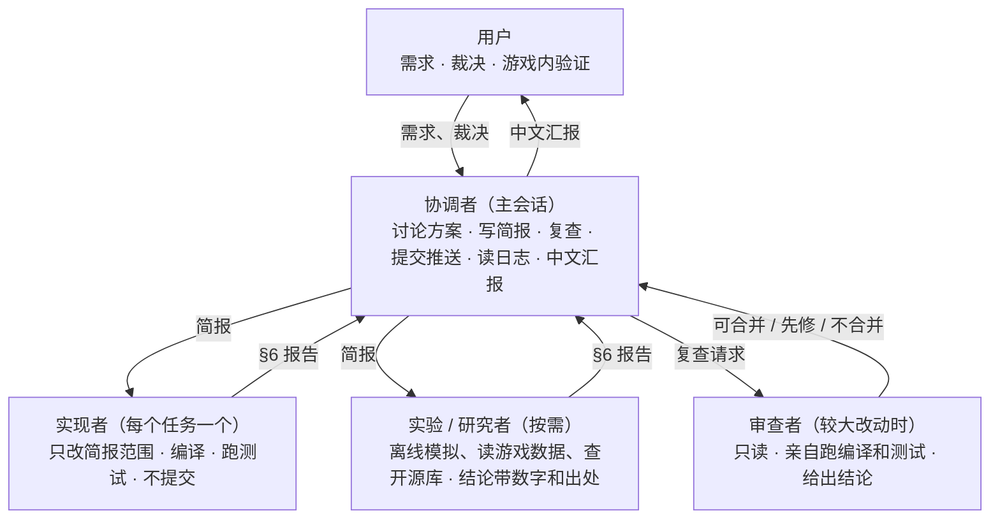
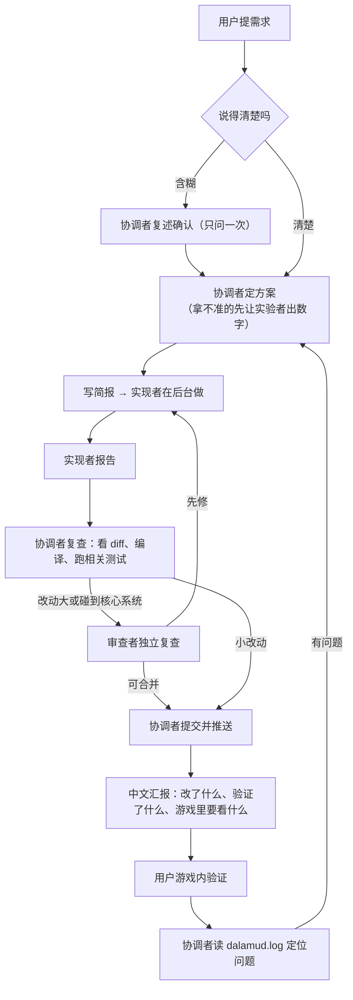

# 工作流：协调者 + 子代理

本文件规定 agent 在本仓库怎么干活（2026-11-14 建立，参照 vestra-player 的 agentic workflow，按本项目的规模简化）。每个会话、每个子代理开工前先读它。流程有变化就改这里，不只留在某个 agent 的记忆里。

本项目只有一个插件仓库，没有 SDK、发版流水线或多方协作，所以只保留三件事：
- 主线专心和用户讨论；
- 实现交给子代理；
- 交付前有人复查。

## 0. 总览



一个任务从需求到推送：



## 1. 角色

| 角色 | 能改什么 | 职责 |
| --- | --- | --- |
| 协调者（主会话） | 文档、1–2 行的小修；git 提交和推送 | 和用户讨论、定方案、写简报、复查、提交推送、读日志、汇报。不亲自写大段实现，主线留给对话 |
| 实现者（每任务一个） | 只限简报列出的文件 / 目录 | 实现、编译、跑相关离线测试，按 §6 报告。**不 commit、不 push** |
| 实验 / 研究者（按需） | 只能新建 `Tests/<Name>/` 实验项目和临时文件 | 离线模拟（例：`Tests/TargetingSim`）、读游戏数据（Lumina）、调研开源库。结论附实际跑出的数字或出处，证据不足就直说 |
| 审查者（按需） | 只读 | 不参与实现。亲自读代码、跑编译和测试，不接受“别人说过了”。结论只有三种：可合并 / 先修 / 不合并 |

- 一个子代理只担一个角色。跨角色的任务由协调者拆开。
- 子代理之间不直接通信，也不再派自己的子代理。

## 2. 什么时候派子代理

- **派**：要改代码并编译的实现、离线实验、需要翻很多文件的调查、独立复查。
- **不派**：读一下日志、查一个值、看一个文件、1–2 行的小修。这些协调者直接做。
- **并发**：同时最多 3 个后台子代理。它们改的文件不能重叠；重叠就排队做。

## 3. 构建与工作区

- 游戏里的开发插件从主检出目录的 `CombatSimulator/bin/Release` 自动重载。
- **一次只有一个实现者在主检出目录里改代码和编译。** 它的编译产物会直接被游戏加载，这正是要交付的东西。
- 需要并行时，第二个实现者在自己的 git worktree 里工作。它在 worktree 里编译，不影响游戏。做完由协调者把改动合回主检出，再编译一次。
- 离线测试项目在 `Tests/` 下，用 `dotnet run -c Release` 跑，不依赖游戏。

## 4. 所有 agent 都遵守的项目规矩

- **语言**：对用户一律用中文，包括回答、汇报、进度说明。仓库里的提交说明用英文；文档中英皆可，跟随所在文件。简报用英文或中文都行；子代理向协调者报告用中文。
- **不碰** `CombatSimulator/Dev/Experimental`（独立仓库，子模块）。提交只用：`git add -A CombatSimulator Tests docs ':!CombatSimulator/Dev/Experimental'`。
- **git**：只有协调者提交和推送，推送用普通 `git push`。任何人都不用 `git stash`，不做强推，不改历史。
- **提交说明**：私有或实验性功能的提交说明保持中性措辞（具体名单协调者知道，子代理按简报写）。提交说明结尾带会话指定的署名行。
- **重写就删干净**：新系统替换旧系统时，旧路径同一批删掉，不留作“退路”。
- **一套数值**：玩家、队友、敌人用同一套伤害和 MP 规则；强度档位只管血量。不给 AI 开数值特例。
- **物理问题用通用机制**，不加特例规则。
- **界面极简**：调试和内部参数不进界面（斜杠命令可以）；选项用下拉菜单，不让用户手填。给用户的界面指引必须写确切的页签名和折叠栏标题，并先查代码核对。
- **改视觉 / 物理 / AI 行为要有离线对照**：先用离线指标证明新版不比旧版差，再交付。不靠截图，不让用户逐项去测。
- **为诊断加日志**：会在游戏里出问题的系统，在 `dalamud.log` 里留一行周期汇总（例：`Crowd:`、`War:`、`Allies (…)`、`Rescue:`、`FrameCost:`），协调者读日志定位问题，不让用户描述细节。
- **默认值**：只改新装和重置后的配置。用户已保存的设置要动，得先问用户。

## 5. 什么时候问用户

**要问**：
- 改用户定过的规则或玩法；
- 删除功能；
- 改会影响已有配置的默认值；
- 需要在体验上取舍；
- 需求互相冲突；
- 没有先例的设计。

问的时候给出：问题、证据、几个选项各自的代价、推荐哪个，最后一句话说清要用户回答什么。只暂停依赖这个决定的那部分工作。

**不问**：
- bug 修复；
- 已定方案内的实现细节；
- 只增不改的小功能；
- 有明确惯例的细节（做了顺带说一声）。

## 6. 简报与报告格式

协调者给子代理的简报包含：

```text
目标（一句话）与背景：用户要什么、已经排除了什么
角色与可改范围：文件 / 目录
要读的文件和文档
验收：编译命令、要跑的测试、要加或要看的日志行、离线指标
禁止事项：不提交不推送、不碰 Dev/Experimental、不扩大范围
报告：按下面的格式，中文
```

子代理结束时的报告：

```text
## 结果
一句话：完成 / 部分完成 / 卡住。

## 改动
- 新增 / 修改 / 删除的文件

## 检查
- 实际跑过的命令 → 结果（退出码、通过/失败数、关键数字）
- 没跑的检查及原因

## 发现但没修的问题（如有）
```

只写实际跑过的检查，没跑的写“未跑”。

## 7. 汇报给用户

每次交付，用中文说清楚四件事：
1. 改了什么；
2. 实际验证了什么（编译、测试、离线数字）；
3. 游戏里需要用户看哪里（确切页签和折叠栏）；
4. 哪些数值是先定的、可以再调。

没在游戏里验证过的，要明说“待游戏内验证”。

## 8. 长期记忆

项目的记忆分四层，各管一件事：

| 层 | 内容 |
| --- | --- |
| `docs/AGENT_WORKFLOW.md`（本文件） | 流程：角色、简报与报告格式、项目规矩 |
| [`docs/PROJECT_LOG.md`](PROJECT_LOG.md) | 现行决定、教训与死路、待游戏内验证、搁置项，以及当前一轮的工作区（黑板） |
| `docs/<FEATURE>.md` | 每个子系统一份，是该子系统需求、设计和代码落点的唯一来源 |
| 协调者的私有记忆 | 用户偏好，以及不能进公开仓库的内容 |

- **持久的决定或教训，在产生它的同一批工作里写进 `PROJECT_LOG.md`**，不只留在某个 agent 的记忆里。
- 一轮结束时，协调者把 §6 工作区折叠进 §2–§5，再清空工作区。
- 改某个领域前，先读 `PROJECT_LOG.md` §2–§4 和对应的 `docs/<FEATURE>.md`。
