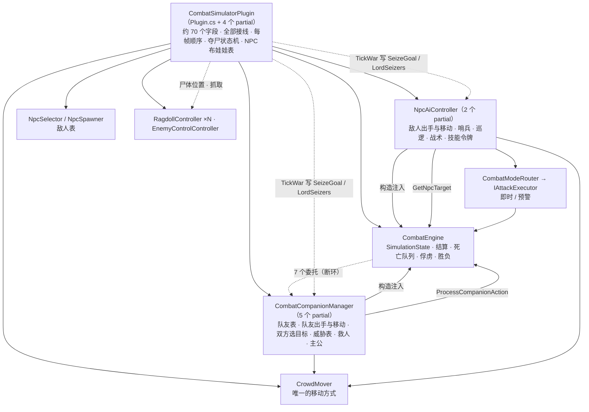
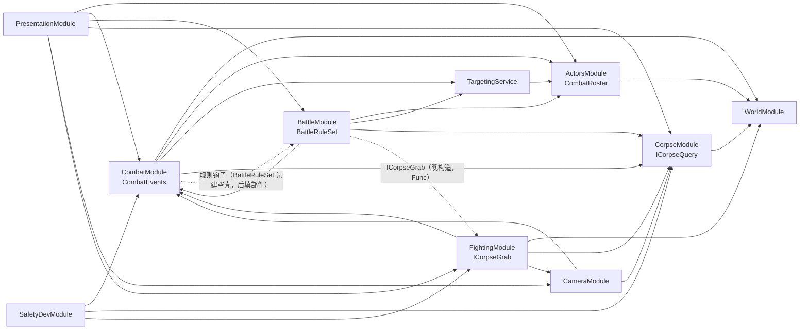

# 插件侧架构设计（重构轨道 B）

状态：设计稿，待用户审阅（2026-11-14）。范围是 [REFACTOR_PLAN.md](REFACTOR_PLAN.md) §4 的细化：战斗、AI、战斗规则、组合根、设置。布娃娃库另见 `docs/RAGDOLL_LIBRARY_ARCHITECTURE.md`（另一位代理撰写），本文只在 §6.5 写插件侧向它要什么。

约束（用户裁决）：重构期间行为完全一致；不重写，小步搬移，每步能编译、能验证；以后还要加战斗模式。

读法：路径相对 `CombatSimulator/`。行号取自 2026-11-14 的工作区；其中 `Plugin.cs` 含另一位代理未提交的 17 行改动，换算到提交 `c0ddb0b`：237–716 行减 1，770 行之后减 17。标“（推断）”的没有在代码里逐行证实。

## 1. 现状



| 状态 | 现在归谁 | 位置 |
| --- | --- | --- |
| 敌人表 `SimulatedNpc` | `NpcSelector.SelectedNpcs` | 每帧传入两个控制器（`Plugin.cs:992`、`:1074`） |
| 队友表 `CombatCompanion` | `CombatCompanionManager.companions` | `Companions/CombatCompanionManager.cs:37` |
| HP / MP / 冷却 / 俘虏标记 | `SimulatedEntityState`，登记在 `CombatEngine.State.Entities` | `Simulation/SimulatedEntityState.cs` |
| **敌人的当前目标** | 队友管理器的 `enemyTargetByEnemyId` | `CombatCompanionManager.cs:41`；引擎经委托 `ResolveNpcTarget` 读（`Plugin.cs:340`、`CombatEngine.cs:1223`） |
| 队友的当前目标 | `CombatCompanion.CurrentTargetId` | `Companions/CombatCompanion.cs:32` |
| 威胁表（双方） | 队友管理器 `threatByEnemy` | `CombatCompanionManager.cs:44` |
| 每个战斗者的选目标状态和随机源 | 队友管理器 `aggro` | `CombatCompanionManager.Aggro.cs:53-65` |
| 敌人战术状态、技能令牌 | `NpcAiController` | `NpcAiController.Tactics.cs:63`、`NpcAiController.cs:179` |
| 救人、祈祷 | 队友管理器 | `.Rescue.cs:67`、`.Lord.cs:49-55` |
| 夺尸进度、抢尸名单、结果 banner | 插件类 | `Plugin.War.cs:37-52` |
| 处刑起手计时、死亡队列、胜负已触发标记 | `CombatEngine` | `CombatEngine.cs:341`、`:163` |

每帧顺序见 §6.4（那张清单就是现状）。

## 2. `Combatant`

### 2.1 基类成员（两个类今天同名同类型的全部成员）

```csharp
namespace CombatSimulator.Combat;

public abstract unsafe class Combatant : ICombatantView
{
    public uint SimulatedEntityId { get; set; }          // 模拟内编号（敌人 0xF0…，队友 0xF1…）
    public int ObjectIndex { get; set; }                  // 客户端对象槽位
    public string Name { get; set; } = string.Empty;
    public BattleChara* BattleChara { get; set; }         // 游戏对象指针
    public nint Address => (nint)BattleChara;
    public IGameObject? GameObjectRef { get; set; }
    public SimulatedEntityState State { get; set; } = new();   // HP、MP、动画锁、读条、俘虏标记
    public NpcBehavior Behavior { get; set; } = new();         // 普攻参数和技能表
    public Vector3 SpawnPosition { get; set; }
    public bool IsSpawned { get; set; }
    public bool IsRanged { get; set; }                    // 一律播放远程动作
    public float AutoAttackTimer { get; set; }
    public float EngageDelayTimer { get; set; }           // 队友侧声明了但没有读写
    public NpcSkill? CurrentCastSkill { get; set; }       // 同上
    public ActorVisualState VisualState { get; set; } = new();
    public bool InReach { get; set; }                     // 站位滞回
    public bool IsAlive => State.IsAlive;                 // 敌人今天写作 State.CurrentHp > 0，等价（SimulatedEntityState.cs:35）
    public float HitboxRadius { get; }                    // 取自 SimulatedNpc.cs:31；队友的 HitboxOf（.Crowd.cs:65）是同一公式、同一回落值 0.5
    public abstract CombatSide Side { get; }              // Enemy / Ally（今天由 State.IsCompanion 表达）
    public abstract CombatPolicy Policy { get; }          // B4 加入：§2.3 三个策略
}
```

`SimulatedNpc`、`CombatCompanion` 保留原名、原命名空间，改为继承它；成员上提后调用点不用改。两个类都不写进用户配置（推断：配置里保存的是 `RecentNpcEntry` 等，见 REFACTOR_PLAN §1），所以不受“类型不能换程序集”限制，但仍留在插件程序集。

### 2.2 留在各自一侧的

| 一侧 | 成员 | 说明 |
| --- | --- | --- |
| 敌人 `SimulatedNpc` | `BNpcBaseId`、`BNpcNameId`、`ENpcBaseId`、`IsClientControlled`、`OriginalModelCharaId`、`ModelChanged`、`OriginalObjectKind`、`OriginalSubKind`、`SpawnPlacementFrames` | 生成与还原 |
| | `AiState`（`NpcAiState`）、`DeadTimer`、`IsEngaged`、`IsAttackingPlayer`、`CrowdDriven`、`WalkPace`、`CastArea` | 敌人状态机与读条区域 |
| | `IsSentry`、`Patrols`、`PatrolGoal`、`HasPatrolGoal`、`PatrolTimer` | 哨兵与巡逻 |
| | `SeizeGoal`、`SeizeHeld` | 夺尸；B5 后由规则钩子给出，字段删除 |
| 队友 `CombatCompanion` | `SourceEntityId`、`IsCatalogNpc`、`CatalogRequest`、`RandomizedLook`、`OriginalEquipment`、`EquipmentVariantApplied` | 克隆来源与外观 |
| | `AiState`（`CompanionAiState`）、`CurrentTargetId`、`NextTargetSelectAt`、`RecentDamage`、`RecentDps`、`DeathAnimationPlayed` | 队友状态机与目标 |
| | `CaptiveEmotePlayed`、`CaptiveLoop`、`ReturningToLord` | 俘虏表情、守尸拴绳 |

`AiState` 两边同名但类型不同（6 个状态对 7 个），到 B9 才合并成一个枚举；之前不动。

### 2.3 只读视图与策略

```csharp
public interface ICombatantView            // 玩家、敌人、队友都能给出；玩家不进 AI，只有这个视图
{
    uint EntityId { get; }                 // 与 State.EntityId 相同
    SimulatedEntityState State { get; }
    CombatSide Side { get; }               // Player / Ally / Enemy
    nint Address { get; }
    Vector3 Position { get; }              // 取代 CombatEngine.GetSimulatedEntityPosition（CombatEngine.cs:1226）
    float HitboxRadius { get; }            // 取代 NpcAiController.EntityHitboxRadius（NpcAiController.cs:1121）
}

public sealed record ReachPolicy(
    bool ScaledBySettings,     // 射程是否乘设置里的缩放
    float MeleeAutoFloor,      // 近战普攻射程下限
    float MagicAutoReach,      // 法系普攻按近战打的距离
    bool SkillsGatedByHp);     // 技能是否受 NpcSkill.HpThreshold 限制

public sealed record ActPolicy(
    SkillChoice Choice,            // RandomReady / HighestPriority
    bool UsesSkillTokens,          // 是否从共享令牌桶取令牌
    bool UsesCastAndTelegraph,     // 是否走读条 / 预警（含“预警未结束不出手”）
    AnimationLockWrite LockWrite,  // MaxWithCurrent / Overwrite
    float AttackLockSeconds,       // 出手后的动画锁
    bool LockTicksWhileDead);      // 死亡后是否继续递减动画锁

public sealed record MovePolicy(
    float SpeedScale, float FallbackSpeed,   // 速度 = MoveSpeed>0 ? MoveSpeed×SpeedScale : FallbackSpeed
    float BaseTurnRate,                      // 弧度/秒
    bool TurnSlowsWithSize,                  // 体型越大转得越慢
    CorpseStepping Stepping,                 // FootSolverLift / StepUpWithin
    float CorpseStepLimit,                   // 可踏上的最大高度差
    bool AddsSpawnHeightOffset,              // 写回高度是否加 DefaultNpcHeightOffset
    bool AppliesMotionInOwnPass);            // 位置写回是否在本侧全部定完目标之后统一做
```

| 字段 | 敌人（现值与出处） | 队友（现值与出处） |
| --- | --- | --- |
| `ScaledBySettings` | 是：非近战 × `clamp(NpcAttackRangeScale, 0.1, 100)`；近战再 × `NpcScale`（开了 `EnableNpcScale` 时，夹在 0.01–3）；下限 0.001（`NpcAiController.cs:1093-1119`） | 否：`SkillReach = skill.Range`（`.Crowd.cs:76`） |
| `MeleeAutoFloor` | 0（`:493`） | 3.0：`max(AutoAttackRange, 3)`（`.Crowd.cs:88`） |
| `MagicAutoReach` | 3.5 × 近战缩放（`:38`、`:492`） | 3.5（`.Crowd.cs:33`） |
| `SkillsGatedByHp` | 是（`:498`、`:829`） | 否 |
| 站位（两边相同，进 `CombatantMath`） | 射程 ≤5：`min(1.0, 射程×0.5)`；否则 `max(1.0, 射程−1.0)`；到位容差 0.25；出射程才重新走（`:471-474`、`:547-554`） | 同（`.Crowd.cs:29-32`、`:110-117`） |
| `Choice` | 就绪技能里随机一个（`:843`） | `Priority` 从高到低第一个就绪的（`CombatCompanionManager.cs:959`） |
| `UsesSkillTokens` | 是：全体敌人共用一个桶，每秒补 `NpcSkillRateLimit`（默认 5，≤0 不限），上限 3；没令牌就改普攻（`:179-192`、`:202`、`:841`） | 否 |
| `UsesCastAndTelegraph` | 是：`IsTelegraphBusy` 时不出手（`:808`）；读条时间 `EffectiveCastTime`，上限 5 s（`:922-937`）；`ActionMode` 为真时不走引擎读条，读条时长交给预警执行器（`:849`） | 否：直接结算 |
| `LockWrite` / `AttackLockSeconds` | `max(现值, 0.6)`（`:873`、`:899`、`:999`） | `= 0.6`（`CombatCompanionManager.cs:979`、`:1002`） |
| `LockTicksWhileDead` | 否：先判死亡再递减（`:655-669`） | 是：先递减再判死亡（`:881`、`:1012`） |
| `SpeedScale` / `FallbackSpeed` | 1.5 / 8.0（默认 `MoveSpeed` 6 → 9.0）（`:517`）；另有巡逻 2.0、冲锋 ×1.8、逃跑 ×0.8、绕步 ×0.55（留在敌人战术里） | 1.0 / 6.0（`.Crowd.cs:141`） |
| `BaseTurnRate` / `TurnSlowsWithSize` | 5.0；开 `EnhancedEnemyTactics` 时按体型放慢，最低 1.2（`.Tactics.cs:100`、`:478`；`EnemyMovementMath.cs:26`） | 6.0；否（`CombatCompanionManager.cs:1401`） |
| `Stepping` / `CorpseStepLimit` | 脚部求解器给的抬升量，`max(0, 骨盆偏移)`（`:597-600`） | 尸体表面比脚高且不超过 0.65 就踏上去（`.Crowd.cs:35`、`:148-151`） |
| `AddsSpawnHeightOffset` | 是（`:600`） | 否 |
| `AppliesMotionInOwnPass` | 是：先全部 `Drive`，再 `ApplyCrowdMotion`（`:305-327`） | 否：每次 `Drive` 后立即取位置写回（`.Crowd.cs:142-154`） |

两边已经相同、不进策略的：MP 回复 134/秒、普攻回 600 MP、技能 MP 按自身蓝池同比例（`CombatBudgetModel.cs:128-129`、`:168`）；出手节奏 `ActionPace()`（`ActionMode` 时为 `ActionEnemyAttackSpeed`，现为 1.2 / 1.6 / 2.0 三档，`Configuration.cs:610`）；移动动画阈值 0.3 m/s。

`ActionMode` 现在是计算属性 `!FightingMode`（`Configuration.cs:515`），所以敌人的引擎读条分支（`:849-864`）只在 Fighting Mode 下走得到。

## 3. 共享出手步骤

### 3.1 签名

```csharp
public interface IAttackSink                       // 一次出手交给谁结算：两侧今天最大的差异
{
    AttackCommit CommitSkill(Combatant self, ICombatantView target, NpcSkill skill, int mpCost);  // Failed / Landed / CastStarted
    bool CommitAutoAttack(Combatant self, ICombatantView target);
}

public readonly struct CombatStepContext
{
    public ICombatAiSettings Settings { get; init; }
    public IAttackSink Sink { get; init; }
    public Random Rng { get; init; }                        // 只有 RandomReady 用
    public SkillTokenBucket? Tokens { get; init; }          // 队友为 null
    public Func<uint, bool> IsTelegraphBusy { get; init; }  // 队友恒为 false
    public Func<uint, int> MpPriceOf { get; init; }         // 技能的玩家价（GetActionData(id)?.MpCost ?? 0）
}

public static class CombatStep
{
    // 目标在射程内、可以出手时调用；返回这一帧做了什么（供活动统计用）
    public static StepResult Run(Combatant self, ICombatantView target, float gap, float dt, in CombatStepContext ctx);
}
```

- `EnemyAttackSink`：包住 `combatModeRouter.AttackExecutor.Execute(npc, NpcAttackRequest)`（`Action/IAttackExecutor.cs`）。`CastStarted` 分支原样做 `NpcAiController.cs:851-863` 的事（置读条状态、当场扣 MP、`BeginSnapshotCast`、战斗日志）。
- `AllyAttackSink`：包住 `combatEngine.ProcessCompanionAction`，成功后做 `RegisterDamage` 和 `AddThreat`（`CombatCompanionManager.cs:971-977`）。队友 `potency == 0` 时走带暴击、直击、伤害倍率的 `Calculate`（`CombatEngine.cs:1101-1104`），这条差异原样留在 sink 后面，见 §10。

### 3.2 伪代码（★ 是两侧今天不同的地方）

```text
Run(self, target, gap, dt, ctx):
  P = self.Policy
  if self.State.AnimationLock > 0                      → 置 ActionLocked 外观；返回 Locked
  if P.Act.UsesCastAndTelegraph && IsTelegraphBusy(id) → 置 ActionLocked 外观；返回 Locked      ★ 只有敌人
  ready = Behavior.Skills 按表内顺序筛：冷却为 0
          && gap <= SkillReach(skill, P.Reach)                                                    ★ 射程缩放
          && (!P.Reach.SkillsGatedByHp || hp比例 <= skill.HpThreshold)                            ★ HP 门槛
          && State.CurrentMp >= EnemySkillMpCost(MpPriceOf(skill), State.MaxMp)
  pick = RandomReady:      ready 非空 && (Tokens == null || Tokens.TryTake()) ? ready[Rng.Next(ready.Count)] : 无   ★
         HighestPriority:  ready 按 Priority 降序的第一个（稳定排序）                                              ★
  if pick:
      r = Sink.CommitSkill(self, target, pick, mpCost)                                            ★ sink
      if r == Landed: MP -= mpCost；pick.CooldownRemaining = pick.Cooldown / Pace；按 P.Act.LockWrite 写 0.6   ★ 写法
      返回（不论成败，这一帧不再普攻）
  self.AutoAttackTimer -= dt；> 0 则返回
  if 法系普攻 && gap > MagicAutoReach(P.Reach) → 返回（计时器不重置）
  self.AutoAttackTimer = AutoAttackDelay / Pace
  if Sink.CommitAutoAttack(self, target): MP = min(MaxMp, MP + 600)；按 P.Act.LockWrite 写 0.6
```

没令牌时落到普攻、不退回技能冷却（`NpcAiController.cs:838-841`）；令牌先取、随机数后抽——这两点由上面的写法保证。

### 3.3 进入 `Run` 之前，各侧控制器自己做的（不合并）

| 步骤 | 敌人（`NpcAiController.TickNpc` / `TickCombat`） | 队友（`TickCompanion`） |
| --- | --- | --- |
| 冷却与动画锁递减 | 冷却 → 判死亡 → 动画锁（`:649-669`） | 动画锁和冷却 → 判死亡（`:881-883`） |
| 死亡处理 | 置 `Dead`、`ApplyDead`；死亡动作和布娃娃由引擎延迟 0.5 s 触发（`CombatEngine.cs:164`，在 `OnEntityDeath` 里排队，`:1818`） | 下一帧在这里播死亡动作、发布娃娃通知、检查全灭（`:883-900`），没有 0.5 s 延迟 |
| 规则接管 | 夺尸目标点在移动里（`:523-531`） | 俘虏 / 祈祷 / 救人，任一接管就返回（`:906`） |
| 没有活目标 | 清出手状态，回 `Idle`（`:731-736`） | 回指挥位置（`:924-933`） |
| 战术 | 逃跑时不出手（`:739`） | — |
| 读条 | 目标变了就取消；区域读条不受射程影响走完；引擎读条推进（`:746-796`） | — |
| 射程判定 | `gap > ReachNow` 就返回（`:764`） | 正在走且 `gap > CrowdReachNow` 才返回（`:939`） |

留在敌人控制器：哨兵感知、巡逻、呼救、自动开战倒计时、战术（逃跑 / 等位 / 绕步 / 冲锋 / 近战名额）、读条与区域快照、被动模式、夺尸移动。留在队友控制器：生成与克隆、指挥锚点与编队、守尸拴绳、救人、祈祷、俘虏表情、DPS 统计。

### 3.4 必须保留的随机数抽取顺序

| 随机源 | 抽取点（按一帧内的先后） |
| --- | --- |
| `NpcAiController.RandomSource`（13 处） | ① 自动开战到点或队友模式强制开战：每个新开战的敌人（按列表顺序）`StaggerTimers` 抽 1 + 技能数，再抽 1 次开战抖动（开了强化战术时）（`:213-237`、`:618-644`、`.Tactics.cs:335`）② 第一遍循环，每个敌人：有就绪技能且拿到令牌时抽 1（`:843`）③ `TickCallForHelp`、`TickSentries`：被叫醒的敌人同 ① ④ `UpdateMeleeAdmission`：每个第一次出现的敌人建战术状态时抽 1（`.Tactics.cs:487`）⑤ 第二遍循环，每个敌人：巡逻到点抽 1、起步抽 2（`:454-459`）；换位判定、弧度、方向各 1；绕步间隔、概率、弧度、方向各 1（`.Tactics.cs:270-305`） |
| 同一个源，控制器之外 | `TickWar` 叫醒抢尸者时的 `EngageNpc`（`Plugin.War.cs:204`），发生在敌人 AI 之前 |
| `CombatCompanionManager.RandomSource`（3 处） | 只在生成时：`AdoptNpc` 抽 1 + 技能数（`:194-200`），克隆抽 1（`:741`） |
| `AggroSeedSource` → 每人一个 `Random` | 某个战斗者第一次被 `AggroOf` 碰到时取种子（先挨打的先取：`NoteHit`，`.Aggro.cs:117`；否则在第一次抽目标时）。每次抽目标：有候选时抽 1 次选人，再抽 1 次保持时长（`.Aggro.cs:182`、`:197`） |
| `DamageCalculator.rng` | 每次结算抽 3 次（暴击、直击、±5%），玩家、队友、敌人共用一条流，按结算先后（`DamageCalculator.cs:86-92`）。现在用无种子的默认构造（`Plugin.cs:209`），带种子的构造函数已有 |
| 仍是 `Random.Shared`（B0 遗留） | 玩家打到未开战敌人时的 `StaggerTimers`（`CombatEngine.cs:2252`）、地图敌人（`MapEnemyController.cs:212`）、可见玩家分边（`CombatCompanionManager.cs:627`）、外观随机 |

战术状态是“第一次用到才建、建的时候抽一次”，所以任何改变 `Tactics(npc)` 首次调用时机的改动都会改变随机序列。

## 4. 选目标

```csharp
public static class AggroModel                     // 纯函数，Tests 直接链接；常量照搬 .Aggro.cs:27-51
{
    public readonly record struct Self(uint Id, Vector3 Position, float Reach, bool Ranged, uint CurrentTarget);
    public readonly record struct Candidate(uint Id, Vector3 Position, float HpShare, uint TargetId);

    // w = (0.25 + 1.5×威胁占比²) ÷ 拥挤 ÷ 距离 × 残血 × 互打 1.5 × 当前目标 6（.Aggro.cs:146-173）
    public static float Weight(in Self self, in Candidate c, float threatShare, int meleeOnIt, int rangedOnIt);
    // 到期：当前目标没了 / 保持时间到 / 被新的人打且已保持 2.5 s / 外部事件（.Aggro.cs:238-240、:278-280）
    public static bool IsDue(AggroState s, float now, bool currentLive, bool externalChange);
    public static uint Draw(AggroState s, IReadOnlyList<(uint Id, float Weight)> weights);   // 按权重抽（.Aggro.cs:175-190）
    public static void Hold(AggroState s, uint target, float now);                           // 保持 4–8 s（.Aggro.cs:192-198）
    public static float EnemyAggroReach(NpcBehavior b);    // 距离项用的射程：远程取普攻射程，否则 max(3, 普攻射程)（.Aggro.cs:221）
}

public sealed class TargetingService               // 有状态：威胁表、每人的 AggroState、敌人当前目标、换目标计数
{
    public TargetingService(CombatRoster roster, ITargetingSettings settings, Func<float> now, BattleRuleSet rules);
    public Random SeedSource { private get; set; }                      // 即今天的 AggroSeedSource
    public SimulatedEntityState? EnemyTarget(SimulatedNpc enemy);       // 今天的 SelectEnemyTarget（CombatCompanionManager.cs:406）
    public uint TargetIdOf(uint fighterId);                             // 双方通用的读取
    public void ForceEnemyTarget(uint enemyId, uint targetId);          // :469
    public void RegisterHit(SimulatedEntityState source, SimulatedEntityState target, int damage);  // .Aggro.cs:108
    public void RegisterPlayerDamage(uint targetId, int damage);        // :371
    public int AttackersOn(uint entityId);                              // .Rescue.cs:184
    public void SelectAllies(float now);  public void SelectEnemies(float now);   // 队友管理器 Tick 里的两段（:316-343），顺序不变
    public void Decay(float dt);  public void Reset();  public void ReportIfDue(IPluginLog log);  // Targets: 行
}
```

- **敌人的当前目标**从队友管理器搬到 `TargetingService`。它只依赖名册、设置和时钟，可以先于引擎构造，引擎构造时直接拿到它，`ResolveNpcTarget`、`ForceNpcTarget`、`OnHit`、`OnPlayerDamageDealt*` 这几个委托就不需要了。
- 队友的当前目标在 B9 之前仍是 `CombatCompanion.CurrentTargetId`，服务读写这个字段。
- 距离项里敌人用的射程（`EnemyAggroReach`）和移动用的 `ReachNow` 不是一个公式（不缩放、近战有 3 的下限），B1 要分开保留。
- **规则怎么加权重**：服务算完通用权重后，乘 `rules.TargetWeight(query)`（各规则部件返回值的乘积，默认 1）。今天散在选目标代码里的规则权重全部搬过去（§5.2）。不属于规则、留在服务里的：玩家选中的敌人 ×2、正在打玩家的敌人 ×1.5（`.Aggro.cs:302-305`）。
- 规则还需要两个不是乘数的钩子：`FilterCandidates`（还有别人可打时把俘虏剔出候选，`:454`；不能改成权重 0，那会改变抽取结果）和 `ForcesRedraw`（持尸者换人、守卫够不着当前目标时立即重抽，`.Aggro.cs:236-240`、`:284`）。

## 5. 战斗规则

### 5.1 接口

```csharp
public interface IBattleRule
{
    string Id { get; }
    void OnBattleStarted(BattleContext ctx);                    // 开始
    void OnReset(BattleContext ctx);                            // 重置或停止；也在本部件被停用时调用
    void TickBeforeAllies(BattleContext ctx, float dt);         // 位置：队友出手之前（今天的 TickRescues / TickLord）
    void TickAfterEngine(BattleContext ctx, float dt);          // 位置：引擎之后、敌人 AI 之前（今天的 TickWar）
    LethalBlow OnLethalBlow(BattleContext ctx, ICombatantView victim, SimulatedNpc by, bool primary);  // Default / Capture
    void OnFighterDown(BattleContext ctx, ICombatantView who);  // 有人倒下
    void OnLordDown(BattleContext ctx);                         // 主公（玩家）倒下，一场只调一次
    bool TakesOverAlly(BattleContext ctx, CombatCompanion ally, float dt);   // 这一帧由规则驱动这名队友，不出手
    EnemyGoal? EnemyGoalFor(BattleContext ctx, SimulatedNpc enemy);          // 敌人去哪、是否边走边打守卫
    float TargetWeight(BattleContext ctx, in TargetQuery q);                 // 选目标权重乘数
    void FilterCandidates(BattleContext ctx, SimulatedNpc enemy, List<ICombatantView> candidates);
    bool ForcesRedraw(BattleContext ctx, Combatant fighter);
    AllyLeash? LeashFor(BattleContext ctx, CombatCompanion ally);            // 锚点、半径、回程比例、空闲站位
    bool SuppressesKillerPossession(BattleContext ctx);         // 玩家死亡时不让 Enemy Control 接管凶手
    OutcomeText? DescribeOutcome(BattleContext ctx, bool playerWon);         // banner 标题和原因
    string? StatusWord(BattleContext ctx, SimulatedEntityState who);         // 血条前缀
}
public abstract class BattleRule : IBattleRule { /* 全部空实现：void 什么都不做，其余返回 null / false / 1 / Default */ }

public sealed class BattleContext
{
    public IBattleRuleSettings Settings { get; }
    public CombatRoster Roster { get; }             // 玩家视图、队友、敌人
    public TargetingService Targeting { get; }
    public ICorpseQuery Corpses { get; }            // 尸体位置、布娃娃是否就绪（§6.5）
    public ICorpseGrab Grab { get; }                // 抓起尸体
    public IBattleMechanics Mechanics { get; }      // 引擎里的机制：TakeCaptive / ReleaseCaptive / 复活 / ForceEnemyVictory / 战斗日志
    public IAllyDriver Allies { get; }              // 让队友走到某点、停下、播放并保持表情、设置受伤倍率
    public float Now { get; }  public bool IsActive { get; }
}
```

`BattleRuleSet` 持有一组有序部件：`Tick*`、`On*` 按顺序全调；返回可空值的查询取第一个非空；`TargetWeight` 取乘积；`bool` 取“任一为真”。机制（俘虏状态、表情保持、处刑起手 1.5 s、复活、强制胜负、全歼敌人时释放俘虏）留在引擎和队友控制器，规则只决定何时用。

### 5.2 现有行为 → 部件与钩子

| 行为 | 现在在哪 | 部件（`Battle/Rules/` 下一个文件） | 钩子 |
| --- | --- | --- | --- |
| Stay down：倒下就不再起来 | 没有代码（缺省） | `BaseRule` | — |
| 全灭 / 全歼的标题和原因；`Fighting`、`Killed in battle` | `Plugin.War.cs:99-106`、`.Lord.cs:345-358` | `BaseRule` | `DescribeOutcome`、`StatusWord` |
| 春秋：分诊（主公 → 坦克 → 其他，近的先；同时最多 ⌈能战队友 ÷ 4⌉ 人；不进敌多我少的 8 m 圈，主公除外） | `.Rescue.cs:86-155` | `SpringAutumnRescueRule` | `TickBeforeAllies` |
| 春秋：跑去、跪 8 s、受伤 ×4、被挤开半速回落、重伤放弃并休息 6 s、50% HP 0 MP 复活；`Rescue:` 日志；`Raising` | `.Rescue.cs:244-321`、`:361-403` | 同上 | `TakesOverAlly`、`StatusWord` |
| 跪地救人者被集火 ×3、队友掩护 ×3 | `.Aggro.cs:201-211`、`:257`、`:306` | `SpringAutumnRescueRule` 与 `LordGuardRule` 各报自己的跪地者 | `TargetWeight` |
| 战国：主公倒下、不撤退 → 剩余队友全部被俘 | `.Lord.cs:93-113` | `WarringStatesLordRule` | `OnLordDown` |
| 战国：主公阵亡仍取胜 → `REMAINS SECURED`；被处决的原因文案 | `Plugin.War.cs:96-103` | 同上 | `DescribeOutcome` |
| 祈祷：最近的队友到尸体正前方 1.3 m 祈祷，受伤 ×4，被推开 1 m 就回去，1.5 s 走不近就原地跪；倒下由下一个接替；`Praying` | `.Lord.cs:123-207` | `LordGuardRule` | `TickBeforeAllies`、`TakesOverAlly`、`StatusWord` |
| 守尸：锚点改为尸体、半径 10 m、越界走回到 70% 才算回来、空闲时站 3 m 的圈；`Guarding` | `.Lord.cs:278-314`、`CombatCompanionManager.cs:1061-1134` | 同上 | `LeashFor`、`StatusWord` |
| 守卫选目标：抢尸者 ×30、离尸体 12 m 内最多再 ×2、够不着的 ×0.05、够不着当前目标立即重抽 | `.Aggro.cs:284`、`:308-315` | 同上 | `TargetWeight`、`ForcesRedraw` |
| 夺尸：存活敌人里离尸体最近的一半去抢，每 3 s 复核，叫醒 40 m 内的哨兵 | `Plugin.War.cs:151-212` | `CorpseSeizureRule` | `TickAfterEngine`、`EnemyGoalFor` |
| 夺尸按人数：3.5 m 内守卫 ≥ 抢尸者就抢不走；1.5 m 内累积 2 s，否则半速回落；布娃娃未就绪最多 95%；`War:` 日志 | `Plugin.War.cs:216-269` | 同上 | `TickAfterEngine` |
| 抢尸者对持尸者 ×100，持尸者换人立即重抽 | `.Lord.cs:244-268`、`.Aggro.cs:236-256` | 同上 | `TargetWeight`、`ForcesRedraw` |
| 抢到：剩余队友被俘、强制战败、抓取每 0.4 s 重试最多 8 s；`DISGRACED`；`Corpse captured`；玩家死亡时不接管凶手 | `Plugin.War.cs:286-331`、`:93`；`.Lord.cs:345`；`Plugin.cs:565` | 同上 | `TickAfterEngine`、`DescribeOutcome`、`StatusWord`、`SuppressesKillerPossession` |
| 人质：致命一击改为留 1 HP 并俘虏 | `CombatEngine.cs:1021-1029` | `HostageRule` | `OnLethalBlow` |
| 人质：还有别人可打时不选俘虏；被处决 → `ROUTED`；`Captive`、`Executed` | `CombatCompanionManager.cs:454`、`Plugin.War.cs:95`、`.Lord.cs:346-349` | 同上 | `FilterCandidates`、`DescribeOutcome`、`StatusWord` |

### 5.3 运行时判断规则开关的地方

直接读开关的表达式我复核到 8 处（其中一处同时读两个开关），加上一处经 `GuardingLord` 间接判断的，共 9 行：

| # | 位置 | 现在的判断 | 改成 |
| --- | --- | --- | --- |
| 1 | `.Lord.cs:61` `GuardingLord` | 战国 && `WarRetreat` && 战斗中 && 主公已死 | `LordGuardRule` 是否生效；它的 13 个读取点（`CombatCompanionManager.cs:914`、`:1037`、`:1071`、`:1084`、`:1094`、`:1122`、`:1123`、`:1176`，`.Aggro.cs:284`、`:295`，`.Lord.cs:246`、`:356`，`Plugin.War.cs:121`）改为 `LeashFor` / `TargetWeight` / `StatusWord` |
| 2 | `.Lord.cs:95` | 战国 && 战斗中 && 主公已死 | 引擎在玩家死亡时调 `OnLordDown` |
| 3 | `.Lord.cs:106` | `!WarRetreat` → 全员被俘 | `WarringStatesLordRule.OnLordDown`，仅当没有 `LordGuardRule` |
| 4 | `.Lord.cs:117` | `!WarRetreat` → 撤销祈祷 | `LordGuardRule.OnReset`（停用时调用） |
| 5 | `.Rescue.cs:83`、`:88` | 规则 == 春秋，否则取消全部救援 | `SpringAutumnRescueRule` 存在；停用时 `OnReset` |
| 6 | `CombatEngine.cs:1021` | `WarCaptives` && 战国 | `rules.OnLethalBlow` 返回 `Capture` |
| 7 | `Plugin.cs:565` | 战国 && `WarRetreat` | `rules.SuppressesKillerPossession` |
| 8 | `Plugin.War.cs:85` | 规则 == 战国（选文案） | `rules.DescribeOutcome` |
| 9 | `Plugin.War.cs:121` | `GuardingLord && !bodySeized` | `CorpseSeizureRule` 内部状态 |

### 5.4 部件怎么组合

```csharp
public static class BattleRuleFactory
{
    public static IReadOnlyList<string> PartsFor(IBattleRuleSettings s) => s.FallenRule switch
    {
        WarFallenRule.SpringAndAutumn => ["base", "rescue"],
        WarFallenRule.WarringStates   => ["base", "lord", .. s.Hostages ? ["hostage"] : [], .. s.Retreat ? ["guard", "seizure"] : []],
        _                             => ["base"],
    };
}
```

| `WarFallenRule` | `WarCaptives` | `WarRetreat` | 部件 |
| --- | --- | --- | --- |
| Stay down | 任意 | 任意 | 基础 |
| Spring and Autumn | 任意（不生效） | 任意（不生效） | 基础 + 春秋救人 |
| Warring States | 关 | 关 | 基础 + 主公倒下 |
| Warring States | 开 | 关 | 基础 + 主公倒下 + 人质 |
| Warring States | 关 | 开 | 基础 + 主公倒下 + 祈祷与守尸 + 夺尸 |
| Warring States | 开 | 开 | 以上全部 |

- 界面上的 Retreat 勾选和 profile 的 `CorpseSeizure` 是同一个开关 `WarRetreat`（`Gui/MainWindow.cs:785`、`:902`），它同时管祈祷、守尸、夺尸。
- 今天这三个设置是每帧现读的，战斗中改了立刻生效（例如关掉春秋会取消进行中的救援，`.Rescue.cs:88-92`）。所以 `BattleRuleSet` 每帧比较这三个值，变了就重算部件表，对被停用的部件调 `OnReset`。部件对象常驻，不重建。
- profile：`CombatRecipe.FallenRule / Hostages / CorpseSeizure`（`Recipes/CombatRecipe.cs:31-35`）开局时写进配置（`Gui/MainWindow.cs:780-787`），走的是同一条路，不用改。

### 5.5 加一个新模式的例子（假想：“斗将”——主公一倒立刻判负，不守尸、不俘虏）

1. 新文件 `Battle/Rules/ChampionDuelRule.cs`，继承 `BattleRule`，重写三个钩子：
   - `OnLordDown`：`ctx.Mechanics.ForceEnemyVictory()`；
   - `DescribeOutcome`：战败时返回 `("CHAMPION SLAIN", "You fell in single combat. The army lays down its arms.")`；
   - `StatusWord`：主公死后给队友返回 `"Yielded"`。
2. 别处要加的行：
   - `Simulation/WarFallenRule.cs`：枚举加一个值 `ChampionDuel`（配置里存的是整数，旧配置不受影响）；
   - `BattleRuleFactory.PartsFor`：一行 `WarFallenRule.ChampionDuel => ["base", "champion"]`，部件登记表一行；
   - `Gui/MainWindow.cs:1911` 下拉名字数组加一个字符串，`:1938` 气泡说明加一行。
3. 不用动：引擎、选目标、两个控制器、`Plugin.cs`。若新模式需要引擎没有的机制（例如“强制判胜”，现在只有 `ForceEnemyVictory`），那是给 `IBattleMechanics` 加一个方法，属于单独的功能提交。

## 6. 组合根

### 6.1 模块与字段

| 模块 | 从 `Plugin.cs:50-137` 拿走的字段 | 对外提供 |
| --- | --- | --- |
| `WorldModule` | `boneTransformService`、`animationController`、`movementBlockHook`、`worldGeometryRenderer`、`worldGeometryPreview`、`navMesh`、`crowdMover`、`vnavmeshIpc`、`glamourerIpc` | 游戏读写、动画、导航 |
| `ActorsModule` | `npcSelector`、`npcSpawner`、`actionDataProvider`、`npcActionProfileProvider`、`mapEnemyController`、`spectatorController`、`npcScaleController`、`companionManager`（生成与名单部分）、`pendingGlamourerApplies` | `CombatRoster` |
| `CombatModule` | `damageCalculator`、`combatEngine`、`npcAiController`、`npcCorpseFootIkSolver`、`combatModeRouter`、`telegraphSystem`、`enemyAreaMarkers`、`playerGuardController`、`actionComboSink`、`actionModeController`、`hitFeedbackController`、`playerTargetController`、`useActionHook`、`virtualEnemyLookAt` | `TargetingService`、`CombatEvents` |
| `BattleModule` | `Plugin.War.cs` 的全部字段（`warBanner`、夺尸进度与名单、抓取重试）、`victoryCelebration` | `BattleRuleSet` |
| `CorpseModule` | `ragdollController`、`npcRagdolls`、`pendingNpcRagdolls`、`pendingNpcRagdollAddresses`、`npcRagdollStaggerBudget`、`weaponDropController`、`dismembermentController`、`armorDetachmentController`、`arrowImpactController`、`playerWeaponVisibilityController` | `ICorpseQuery` |
| `CameraModule` | `cameraModeCoordinator`、`gameCameraUpdateHook`、`activeCameraController`、`dynamicCameraController` | — |
| `FightingModule` | `fightingModeController`、`fightingCombatController`、`enemyControlController` | `ICorpseGrab`、“谁被外部接管”的查询 |
| `PresentationModule` | `mainWindow`、`hpBarOverlay`、`damageNumbers`、`combatLogWindow`、各 overlay、`enemyOmenVfx`、`voiceDirector`、`updateLogPopupController` | — |
| `SafetyDevModule` | `hookSafetyChecker`、`devExperimental`、`Plugin.cs:80-96` 的 partial 钩子 | — |

插件类只剩：构造各模块、宿主事件（5 条）、斜杠命令、§6.4 的每帧清单、§6.3 的订阅清单。



两个仍然绕回来的依赖：引擎要调规则钩子，而规则部件要用引擎的机制——`BattleRuleSet` 先以空表构造并注入引擎，部件在 `BattleModule` 里填入；`FightingModule` 晚于 `CombatModule` 构造，“谁被外部接管”和抓取继续用 `Func` 传。

```csharp
public sealed class CombatRoster                   // 只读名册：谁在场。取代断环用的查询委托
{
    public ICombatantView Player { get; }
    public IReadOnlyList<SimulatedNpc> Enemies { get; }          // = NpcSelector.SelectedNpcs
    public IReadOnlyList<CombatCompanion> Allies { get; }        // = CombatCompanionManager.Companions
    public bool HasLivingAllies { get; }                         // 合并今天完全相同的 HasActiveCompanions / HasLivingCompanions
    public nint? AddressOf(uint entityId);                       // 今天的 ResolveAddress（:466）
    public ICombatantView? Find(uint entityId);
    public void CollectPartyPositions(List<Vector3> into);       // :93
}

public sealed class CombatEvents                   // 类型化事件；订阅集中在插件类一处，顺序即书写顺序
{
    public event Action? SimulationStarted;  public event Action? SimulationReset;
    public event Action<bool>? OutcomeDecided;
    public event Action<SimulatedEntityState, DamageResult, SimulatedEntityState?>? DamageLanded;
    public event Action<nint>? EnemyDied;  public event Action<nint>? AllyDied;  public event Action<nint>? AllyRevived;
    public event Action? BeforePlayerDeath;  public event Action<nint>? PlayerDied;  public event Action? PlayerDamaged;
    public event Action<uint>? PlayerHitBy;  public event Action<SimulatedNpc, NpcAttackRequest>? AttackCommitted;
}
```

### 6.2 构造后的接线怎么分类

我按同一口径重数：`Plugin.cs` 构造函数里 81 条委托赋值或事件订阅（另有 3 条普通赋值不算），`Plugin.Victory.cs` 6 条、`Plugin.Voice.cs` 6 条、`Plugin.War.cs` 2 条，合计 95 条；去掉 5 条宿主事件是 90 条（调查报告的数字是 88，差别在对象初始化器里的委托算不算）。打在 `CombatEngine` 上的是 33 条，与调查一致。

| 类别 | 去向 | 约数 | 例子（行号） |
| --- | --- | --- | --- |
| 断环用的查询 | 构造注入 `TargetingService` / `CombatRoster` / `ICorpseQuery` | 18 | 引擎 ↔ 队友管理器的 7 条（`:340-346`）；`CollectPartyPositions`（`:367`）；`IsSourceEnemy`（`:448`）；`LordBodyPosition`、`BodyPositionOf`（`:379-380`）；`CorpseSupportHeightProvider` ×2（`:376`、`:378`）；`GetRagdollBonePosition`（`:426`） |
| 通知 | `CombatEvents` 上的类型化事件 | 32 | `OnSimulationStarted` ×3、`OnSimulationReset` ×9、`OnOutcomeDecided` ×2、`OnDamageLanded` ×2（`:612-613`）、`OnNpcDeathRagdoll`（`:539`）、`OnPlayerDeath`（`:546`）、`BeforePlayerDeath`（`:439`）、队友的生成 / 死亡 / 复活 / 报错（`:450-465`）、`AttackCommitted`（`Plugin.Voice.cs:25`） |
| 已构造对象的属性注入 | 改成构造参数（模块顺序理顺后） | 14 | `AreaMarkers`、`Crowd` ×2（`:364-366`）、`Navmesh`（`:368`）、`FootIkSolver`（`:377`）、`MonsterKits`（`:219`）、`PlayerRagdollController`（`:239`） |
| 晚构造的依赖、可选子模块 | 保留为 `Func` / 接口属性 | 26 | 外部接管查询（`:359`、`:382`、`:423`）、`IsTargetSuperArmored`（`:309`）、`InterruptTelegraphCast`（`:375`）、`GetLockedTargetId`（`:391`）、子模块给的 5 条（`:330-336`）、镜头 6 条（`:267-268`、`:289`、`:400-408`）、Fighting 4 条（`:427-438`）、界面 8 条 |
| 宿主事件 | 留在插件类 | 5 | `:651-655` |

约数是按上表逐条归类后数的，个别条目归哪一类有商量余地；B7 的简报里要附逐条清单。

### 6.3 订阅顺序（必须保留）

`OnSimulationReset`（从 `StopSimulation` 和 `ResetState` 都会触发，`CombatEngine.cs:279`、`:335`），按现在的订阅先后：

| # | 订阅者 | 位置 |
| --- | --- | --- |
| 1 | `telegraphSystem.Clear` | `Plugin.cs:304` |
| 2 | `enemyAreaMarkers.Clear` | `:305` |
| 3 | `hitFeedbackController.Clear` | `:307` |
| 4 | `NpcAiController.OnSimulationResetOrStop`（在它自己的构造函数里订阅） | `Ai/NpcAiController.cs:72`，构造于 `Plugin.cs:354` |
| 5 | 战斗中重置时切到 Directed 镜头 | `:485` |
| 6 | 大清理：可选模块的导演 → NPC 布娃娃 → 掉落武器 → 部件 → 护甲 → 缩放 → 子模块瞬时状态 → Enemy Control → Fighting → 动态镜头 → 队友（重置时回满，停止时清除）→ 敌人重新生成 | `:509-537` |
| 7 | `voiceDirector.Reset` | `Plugin.Voice.cs:26`（`InitVoice` 调用于 `Plugin.cs:607`） |
| 8 | `damageNumbers.Clear` | `:615` |
| 9 | `ResetWar` | `Plugin.War.cs:62`（`WireWar` 调用于 `:616`） |

`OnSimulationStarted`：① `NpcAiController.ScheduleAutoEngage`（`NpcAiController.cs:71`）② 切 Directed 镜头（`:483`）③ 把已生成的敌人重新登记进选择器（`:490`）。

`OnOutcomeDecided`（靠赋值串联）：① 观众反应（`Plugin.Victory.cs:38`，是 `=` 赋值，会盖掉之前的任何订阅；`WireVictoryCelebration` 调用于 `Plugin.cs:347`）② `ShowOutcome`（`Plugin.War.cs:57` 包住前一个）。

改成 `CombatEvents` 后，这三张表在插件类里各写成连续的一段 `+=`，一眼能看出顺序。第 4 条要从 `NpcAiController` 的构造函数里挪出来才能进这张清单。子模块是否也订阅了这些事件我没有看（不能打开），由协调者用含子模块的构建确认。

### 6.4 每帧顺序清单（必须保留；`OnFrameworkUpdate`，`Plugin.cs:945-1089`）

| # | 调用 | 行 | 战斗未激活时 |
| --- | --- | --- | --- |
| 1 | `npcSelector.Tick` → `npcSpawner.Tick` | 988、991 | 跑 |
| 2 | **`companionManager.Tick`**：衰减威胁 → 队友选目标 → 敌人选目标 → `TickRescues` → `TickLord` → 每个队友出手与移动 → `Allies`、`Targets:` 日志（`CombatCompanionManager.cs:296-353`） | 992 | 跑 |
| 3 | Glamourer 排队、`animationController.Tick`、`victoryCelebration.Tick`、护甲 | 993–997 | 跑 |
| 4 | 镜头：Fighting → 动态镜头 → 可选模块的导演 → 镜头钩子 → 仲裁 → 主动镜头 | 1002–1008 | 跑 |
| 5 | `playerTargetController.Tick` | 1012 | 跑 |
| 6 | **预警结算**：`playerGuardController` → `telegraphSystem` → `enemyAreaMarkers` → `enemyOmenVfx` | 1019–1022 | 跑 |
| 7 | `fightingCombatController`、`actionModeController`、`hitFeedbackController` | 1026–1034 | 跑 |
| 8 | 观众、子模块世界级、缩放、箭 | 1038–1041 | 跑 |
| 9 | **导航网格** `EnsureAround`（仅战斗中）、`navMesh.Tick`；世界几何；可选模块的效果 | 1043–1048 | 跑 |
| 10 | **语音** `TickVoice` | 1050 | 跑 |
| 11 | **人群步进** `crowdMover.Update` | 1054 | 跑 |
| — | 战斗未激活则返回；钩子不健康则急停；可选模块的导演进行中则返回 | 1056–1069 | |
| 12 | `mapEnemyController.Tick` | 1070 | — |
| 13 | **`combatEngine.Tick`**（推进模拟时间、玩家动作、死亡队列、延迟命中） | 1071 | — |
| 14 | `ProcessPendingNpcRagdolls` | 1072 | — |
| 15 | **`TickWar`**（写抢尸名单和 `SeizeGoal`） | 1073 | — |
| 16 | **`npcAiController.Tick`**（出手 → 呼救 → 哨兵 → 近战名额 → 定目标点 → 写回上一步人群的位置 → `Enemies` 日志，`NpcAiController.cs:194-329`） | 1074 | — |
| 17 | `victoryCelebration.Reassert` → `fightingModeController.ReapplyLane` → `devExperimental.Tick` | 1076–1082 | — |

由这张表得出的三条事实：队友在人群步进之前、模拟时间推进之前出手，战斗外也被驱动；敌人在之后；`TickWar` 写的抢尸名单敌人 AI 当帧就用，双方选目标到下一帧（第 2 步）才看到。

### 6.5 插件侧向布娃娃库要什么

```csharp
public interface ICorpseQuery                      // 由 CorpseModule 实现，背后是布娃娃控制器
{
    Vector3? BodyPositionOf(nint actorAddress);    // 骨盆位置；没有已激活的布娃娃返回 null（Plugin.War.cs:273-284）
    bool IsBodyReady(nint actorAddress);           // 布娃娃已激活、可以被抓（Plugin.War.cs:253）
    float? WalkableSurfaceHeight(nint actorAddress, Vector3 at);   // 踩尸体用的表面高度（Plugin.cs:1365-1397）
}
public interface ICorpseGrab                       // 由 FightingModule 实现，背后是 EnemyControlController
{
    bool TryGrab(SimulatedNpc by);                 // 今天的 ControlKiller + OnAttackInput（Plugin.War.cs:296-308）
    bool IsHolding { get; }                        // IsHoldingGrab
}
```

对库的要求只有三条：按身体部位取刚体世界位置（今天按骨名 `"j_kosi"` 取）、“是否已激活”、可行走表面高度查询。抓取本身不在本文范围。

### 6.6 含子模块的构建

插件类是 `partial`，并声明了 14 个由别处实现的 partial 方法（`Plugin.cs:80-96`）；另有 `internal VictoryCelebration`（`Plugin.Victory.cs:17`）和 `public WorldGeometry`（`Plugin.cs:105`）。子模块可以含有插件类的 partial 文件，所以插件类的**任何私有字段**都可能被它引用（推断，我没有打开子模块）。规则：

1. 字段搬进模块时，插件类上留一个同名的私有转发属性（`private CombatEngine combatEngine => combat.Engine;`）。
2. 公开成员改名或改签名前，协调者先用含子模块的构建确认。
3. 转发属性只有在协调者确认子模块不用之后才删。
4. 每个阶段两种构建都要编译通过（公开构建用 `-o` 输出到仓库外）。

## 7. 设置

```csharp
public interface ICombatAiSettings               // 敌人与队友 AI 实际读到的全部设置（Ai/ 17 个、Companions/ 11 个，去重后 24 个）
{
    bool EnableCombatCompanions { get; }  int CombatCompanionMaxCount { get; }  bool SensePartyMembers { get; }
    bool EnableMapPlayerEnemySensing { get; }  bool PartyCompanionDeathRagdoll { get; }
    float PartyCommandRange { get; }  float PartyCommandRangeRandomness { get; }  bool DevCompanionAppearanceVariant { get; }
    bool EnableNpcAutoEngage { get; }  float NpcAutoEngageDelay { get; }  bool EnableNpcTargetPlayer { get; }
    bool ActionMode { get; }  float ActionEnemyAttackSpeed { get; }  float NpcSkillRateLimit { get; }
    bool EnemyTelegraphRealShapes { get; }  bool EnableNpcScale { get; }  float NpcScale { get; }  float NpcAttackRangeScale { get; }
    bool EnhancedEnemyTactics { get; }  bool TacticsRespectEngage { get; }  bool TacticsCharge { get; }  int EnemyTacticsMeleeAttackers { get; }
    bool NpcCollisionActive { get; }  float DefaultNpcHeightOffset { get; }
}
public interface IBattleRuleSettings             // 属性名与 Configuration 不同的用显式接口实现
{
    WarFallenRule FallenRule { get; }            // Configuration.WarFallenRule（int）
    bool Hostages { get; }                       // WarCaptives
    bool Retreat { get; }                        // WarRetreat
    uint CaptiveEmoteId { get; }                 // WarCaptiveEmoteId
    bool ShowResultBanner { get; }  bool EnableRagdoll { get; }
}
public interface ITargetingSettings { bool EnableCombatCompanions { get; } }   // 选目标的权重都是代码常量，不是设置
```

`Configuration : IPluginConfiguration, ICombatAiSettings, IBattleRuleSettings, ITargetingSettings`。接口只读；`EnableCombatCompanions` 由生成队友时写（`Plugin.cs:372`），那一处继续直接写 `Configuration`。

存储结构不动（JSON 保持平铺）的理由：

- 配置按“类型名, 程序集名”保存嵌套对象（`$type`）。把设置分组成嵌套对象，等于新增一批写进配置的类型，以后这些类型再也不能改名或换程序集，旧配置还要写迁移。
- 退役键清单 `RetiredOptionNames`（`Configuration.cs:708` 起）和 `[JsonExtensionData]`（`:121`）都按顶层属性名工作。
- “恢复默认”是按属性名对 `Configuration` 做反射（`:262-272`、`:917-930`），分组后要重写。
- 界面有一千多处直接读写这些属性，不值得动。

好处照样拿到：模块只见自己那个接口；测试用一个二十几行的假设置对象，不必构造 `Configuration`（它实现 Dalamud 的接口，离线测试链接不了）。

## 8. 验证

### 8.1 `Tests/CombatReplay`

难点：两个控制器是 `unsafe` 的，直接读写游戏对象指针，现在离线跑不起来。所以金样分两层：

| 层 | 何时可录 | 录的是什么 | 保护哪一步 |
| --- | --- | --- | --- |
| 函数级 | B1 搬完之后 | `CombatantMath`、`AggroModel` 每个函数在一张固定输入表上的输出 | B1 之后的所有阶段。B1 本身靠“原样搬移”保证：旧的私有方法先留成一行转发，diff 里能看到函数体没变 |
| 回合级 | B4a 之后（§9）：两个**旧**出手循环经接缝改成可离线运行 | 旧循环在假世界里逐帧的决定 | B4b 合并出手步骤、B5、B6、B9 |

- **假世界**：平面上的点（位置、朝向、半径），实现两个控制器经接缝要的东西：读位置和半径、写朝向、“朝目标点以给定速度走”（直线匀速，代替人群和导航网格）、外观状态写入（只记录）。结算用生产代码：`DamageCalculator`、`CombatBudgetModel`、`SimulatedEntityState`、`NpcBehavior`、真实的技能表数据（固定的一小份）。时间步：固定 1/60、固定 1/30、一段带抖动的固定序列各一遍。
- **不假装的**：导航、身体阻挡、动画、预警的命中判定（假世界里预警按时长到点即命中）、布娃娃（“是否就绪”按脚本给出）。这些由游戏内日志覆盖。
- **金样内容**（文本，一帧一行或多行）：帧号；每个战斗者的目标、这一帧的动作（无 / 普攻 / 技能编号 / 读条开始）、HP、MP、动画锁、普攻计时、各技能冷却、`InReach`、位置；规则事件（派人救、救起、祈祷者上任、夺尸进度、被俘、处决、结果标题）。浮点数按原始位写成十六进制。
- **“一致”的含义**：同一台机器、同一运行时下，重构前后的金样文件逐字节相同。不同机器上数学函数结果可能差最后一位，那时由协调者在基线提交上重录再比。
- **场景**：① 野战 8 对 8 近战，Stay down ② 混编（远程、法系、蓝量见底、技能令牌限流）③ 春秋：有人倒下，分诊与被打断 ④ 战国不撤退、开人质：被俘与处决 ⑤ 战国撤退：祈祷、守尸、人数判定、被抢 ⑥ 同 ⑤ 但守住 ⑦ 哨兵、巡逻、呼救、强化战术（逃跑、绕步、近战名额设为 3）⑧ 20 对 20 跑 120 s。每个场景 3 个种子。
- **种子注入**：`NpcAiController.RandomSource = new Random(s)`、`CombatCompanionManager.RandomSource = new Random(s+1)`、`AggroSeedSource = new Random(s+2)`、`new DamageCalculator(new Random(s+3))`。仍用 `Random.Shared` 的几处（§3.4 末行）场景里不触发；若要覆盖，B1 顺手改成可注入（默认不变）。

### 8.2 现有测试

- `Tests/TargetingSim`：B1 改为链接 `AggroModel`，重跑 100 种子，与 PROJECT_LOG §2 记录的数字对照（野战胜率 98%、守尸 45%、每分钟换目标 3.7 次）。它原来测的是自己的副本，数字有出入要先解释再继续。
- `Tests/AiMovement`：已链接 `EnemyMovementMath`；`CombatantMath` 搬出后一并链接，输出应逐字节不变。
- `Tests/CombatBalance`：已链接 `DamageCalculator`、`CombatBudgetModel`；B6 合并两条结算后必须逐字节不变。

### 8.3 游戏内日志（统计对比，不是逐位）

| 日志行 | 出处 | 看什么 |
| --- | --- | --- |
| `Allies (share of ally-frames over 5 s, …)` | `.Crowd.cs:61` | in reach / walking in / no target / back to the lord / praying 各占比 |
| `Enemies (share of enemy-frames over 5 s, …)` | `NpcAiController.cs:144` | 9 类占比；`casting` 在动作战斗下恒为 0 |
| `Targets: enemies … switches / … draws, allies …` | `.Aggro.cs:96` | 双方换目标次数与抽取次数 |
| `Rescue: …` | `.Rescue.cs:151` | 进行中、跪地、救起、放弃、施救者倒下 |
| `War: lord's body at …` | `Plugin.War.cs:261` | 抢尸人数、守卫人数、进度 |
| `Crowd:`、`FrameCost:` | 导航、`Plugin.FrameCost.cs` | 拒绝数、帧耗时 |

每个阶段合入后，在 B0 录基线的同样三个场景上各跑一场，比较各行的占比和每分钟次数；差异超出同一版本两次运行之间的波动就查。

## 9. 与 B1–B9 的对应，以及建议的调整

| 阶段 | 本文对应 | 动的文件 | 与布娃娃库工作重叠的文件 |
| --- | --- | --- | --- |
| B1 | §3.4、§4 `AggroModel`、`CombatantMath`、§8.1 函数级 | `Ai/`、`Companions/`、新 `Combat/`、`Tests/` | 无 |
| B2 | §2.1、§2.2 | `Npcs/SimulatedNpc.cs`、`Companions/CombatCompanion.cs`、新 `Combat/Combatant.cs` | 无 |
| B3 | §5.3 具名查询；夺尸状态机搬出 | `Plugin.War.cs`、`Companions/`、`Simulation/CombatEngine.cs`（一行） | `Plugin.cs`（一两行接线） |
| B4 | §2.3、§3 | `Ai/`、`Companions/`、新 `Combat/` | 无 |
| B5 | §5.1–§5.4 | `Companions/*.Lord.cs`、`*.Rescue.cs`、新 `Battle/Rules/` | 无 |
| B6 | 引擎两条结算合并；规则钩子接进引擎 | `Simulation/CombatEngine.cs` | `CombatEngine.cs`（构造时拿 `RagdollController`，`Plugin.cs:269-272`；玩家死亡时激活布娃娃，`CombatEngine.cs:1716-1721`） |
| B7 | §6 | `Plugin*.cs`、新 `Modules/` | `Plugin.cs`（现在就有库那边未提交的改动） |
| B8 | §7 | `Configuration.cs`（只加接口声明） | 无 |
| B9 | 一个控制器、一个状态枚举 | `Ai/`、`Companions/` | 无 |

B0–B5 不碰 `Animation/` 和 `AdvancedRagdoll/`；真正共用的文件只有 `Plugin.cs` 和 `CombatEngine.cs`。

建议的三处调整：

1. **B8 里战斗用到的那部分提前到 B1 之前**（只是给 `Configuration` 加三个接口声明，零风险）。理由：共享函数、规则部件、离线回放都要拿设置，而 `Configuration` 离线链接不了；不先有接口，B1 的测试就只能再抄一份设置。
2. **B4 拆成 B4a 和 B4b**。B4a：在两个旧循环里把读写游戏对象的地方换成一个窄接缝（位置、半径、朝向、移动、外观），游戏侧适配器做的是原来那几行指针操作；逻辑一行不改；然后用旧循环录回合级金样。B4b：才合并出手步骤，和金样逐字节比。理由：不这样做，B4 这个中高风险阶段就没有重构前的金样可比，只能靠游戏内统计。这和布娃娃库“先接缝、再搬”的做法一致。
3. **`TargetingService` 的状态搬移提前到 B2 之后**（新阶段 B2b）：先作为队友管理器内部持有的对象，管理器的公开方法原样转发，`Plugin.cs` 接线不动；到 B7 再改成构造注入。理由：B5 的规则钩子（`TargetWeight`、`FilterCandidates`、`ForcesRedraw`）要挂在它上面，等到 B7 太晚。

## 10. 待用户裁决的问题与风险

### 10.1 问题

| # | 问题 | 选项与代价 | 建议 |
| --- | --- | --- | --- |
| 1 | 队友和敌人每帧在不同时刻出手（队友在人群步进和模拟时间推进之前，战斗外也跑；敌人在之后）。合并成一个控制器后要不要统一？ | A 保留两个调用点：零行为变化，合并后的控制器有两个入口。B 统一到一处：代码更干净，但队友的出手会晚或早一帧，回放金样全部要重录，属于行为变更 | A；B 以后单独提 |
| 2 | 死亡处理时机不同：敌人的死亡动作和布娃娃由引擎延迟 0.5 s 触发；队友在下一帧自己的 tick 里立即处理，没有延迟 | A 原样保留（合并后仍是两条路）。B 统一成引擎的延迟队列：队友倒地会晚 0.5 s，看得出来 | A；要统一先问 |
| 3 | 队友技能 `potency == 0` 时走带暴击、直击、伤害倍率的路径，敌人不会（`CombatEngine.cs:1101-1104`）。内置队友模板的技能都带威力（`NpcBehavior.cs:64-99`），目录生物当队友时用的技能表是否都带威力没有核实 | A 重构中原样保留在 `AllyAttackSink` 后面。B 现在就统一成一条路：若存在威力为 0 的队友技能，伤害会变 | A；另派一个只读调查，确认有没有威力为 0 的队友技能，再决定是否按“一套数值”修 |
| 4 | 新战斗模式在设置和 profile 里怎么表示？ | A 继续用 `WarFallenRule` 枚举加值：改动最小，但“复活规则”这个名字会越来越不贴切。B 新增一个“模式”设置，三个旧开关留作该模式的选项：要动界面和 profile 格式 | A，直到出现和“倒下后怎样”无关的模式 |
| 5 | 建议的阶段调整（§9 三条）是否采纳 | 采纳：多两个小阶段，B4 有金样可比。不采纳：B4 只能靠游戏内统计 | 采纳 |

### 10.2 合并时必须原样保留（或单独提出来改）的差异

除上面 1–3 外：动画锁写法（敌人取大、队友覆盖）与递减时机（§2.3）；射程缩放、近战下限、HP 门槛（§2.3）；选技能方式与令牌（§2.3）；选目标距离项里敌人用的第三个射程公式（§4）；敌人命中的威胁登记走引擎的 `OnHit`，队友的在控制器里登记（§3.1）；队友带威力出手时伤害类型固定为物理，敌人会传技能的伤害类型（`CombatEngine.cs:1100` 对 `:882`）；位置写回时机（敌人统一写回，队友逐个写回）；队友每次移动都登记防止服务器拉回，敌人只对真实地图 NPC 登记（`.Crowd.cs:153` 对 `NpcAiController.cs:314`）。

### 10.3 风险

- **随机序列**：战术状态“首次使用时创建并抽一次”（§3.4）。合并和搬移最容易在这里无意改变顺序，回合级金样会第一时间报出来，但前提是 B4a 先做。
- **规则每帧现读**：部件表按设置变化重算（§5.4）若漏了某个停用路径（取消救援、撤销祈祷、放回抢尸者），表现为战斗中切换规则后状态残留。场景 ③⑤ 各加一次中途切换。
- **订阅顺序**：`NpcAiController` 在构造函数里订阅事件，位置由构造顺序隐含决定（§6.3 第 4 条）；B7 挪动构造顺序时容易变。
- **子模块**：看不到它引用了插件类的哪些成员，也看不到它是否订阅了引擎事件；全靠协调者的含子模块构建把关（§6.6）。
- **`Plugin.cs` 冲突**：布娃娃库的工作现在就在改它；B3、B5 的接线改动尽量小，B7 排在库落地之后（计划已如此）。
- **回放的盲区**：导航、身体阻挡、预警命中、布娃娃时机不在离线回放里；这些只能靠 §8.3 的日志统计和用户在游戏里看。
- **文档与代码的出入**（不影响方案，记一笔）：[WAR_GENERATOR.md](WAR_GENERATOR.md) §4.3 写的守卫对抢尸者“+400”、结果标题“DEFEAT / BODY RECOVERED”是旧值，代码里是 ×30（`.Aggro.cs:46`）和 `DISGRACED / ROUTED / ANNIHILATED / REMAINS SECURED`（`Plugin.War.cs:94-103`）。
