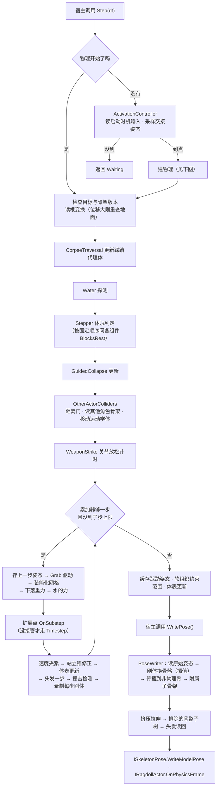
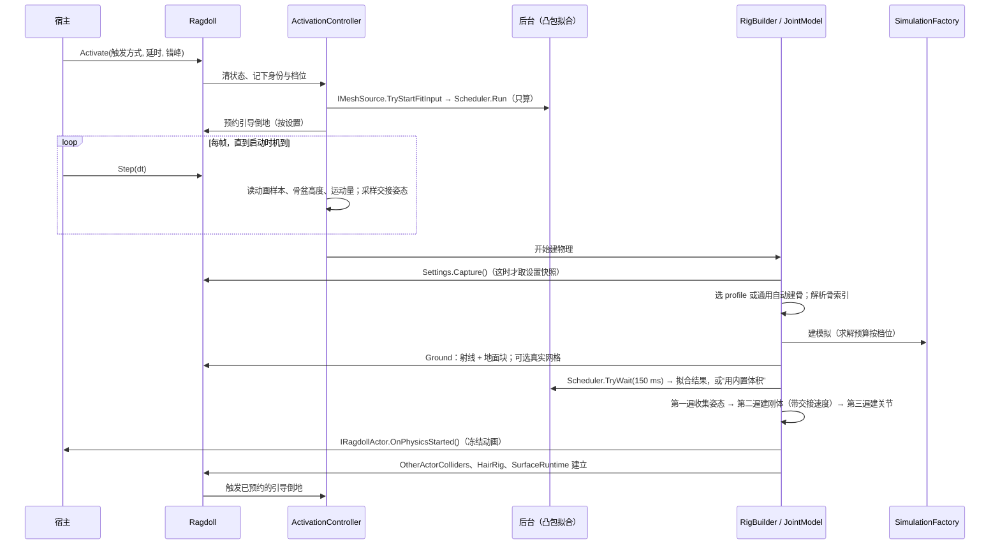

# 布娃娃库架构设计（供用户评审）

状态：设计稿，2026-11-14。评审通过前不做任何结构改动。依据：[REFACTOR_PLAN.md](REFACTOR_PLAN.md) §3、[PROJECT_LOG.md](PROJECT_LOG.md) §2/§3/§6，以及实际代码。

- 行号取自 2026-11-14 的工作区（含尚未提交的 A0 录制改动）。不带文件名的行号都指 `CombatSimulator/Animation/RagdollController.cs`；`Rec:` 指 `RagdollController.Recording.cs`。
- 标“推断”的没有在代码里逐行核实；没标的都对照过代码。
- 命名空间暂写作 `RagdollLib.*`（工作名，见 §10）。
- 私有或实验性功能不在本文描述，统一称“可选模块使用的扩展点”。

## 1. 范围与非目标

**库做的事**：给一副骨架建刚体和关节；按固定步长推进；把刚体姿态换回骨骼姿态并传播到非物理骨；地面与水；其他角色的碰撞体；头发；抓取、冲量、引导倒地、站立支撑、尸体可踩踏支撑；外部刚体与外部骨架（掉落物）；网格体积与凸包拟合的计算部分；调试数据；录制与回放。

**库不做的事（留在宿主）**：

| 不做 | 今天在哪 |
| --- | --- |
| 渲染钩子、每帧何时调用 | `BoneTransformService.cs:28`、订阅在 2728 |
| 读模型文件、种族变形文件、模组路径解析 | 6585–7450、`RagdollController.ModelGeometryData.cs`、`.RenderedGeometry.cs`、`.RenderedPartials.cs`、`.StructuralMeshFit.cs:96–205` |
| 遍历游戏碰撞场景 | `WorldCollisionMesh.cs`、`BGCollisionModule` 调用（`Rec:600`） |
| 冻结 / 恢复动画 | 5640–5642、8197、2860 |
| 防剔除跟随（写渲染对象位置） | 2759–2790、8857–8878 |
| 隐藏肢体等渲染手法 | 3191–3275 |
| 调试界面的绘制 | `Gui/RagdollDebugOverlay.cs`（库只给数据） |
| 用户配置的存储与界面 | `Configuration.cs` |
| 何时让谁变成布娃娃（死亡管线） | `Simulation/CombatEngine.cs:1703–1734`、`Plugin.cs:1150–1320` |

不重写：下面每个组件都是现有代码的搬移和切分。每一步用 §8 的回放证明逐位相同。

## 2. 面向宿主的 API

### 2.1 决定与理由

| 问题 | 决定 | 理由 |
| --- | --- | --- |
| 姿态语义 | **模型空间**（相对骨架根变换），根变换单独给 | 现有代码全程读写模型空间（读 8656–8661，写 8773–8789，换算 3275–3285）。改成局部空间要多一轮浮点运算，逐位对照就废了。只有局部空间的引擎在适配器里换算，库提供一个可选的纯函数助手 |
| 批量还是逐骨 | **批量，`Span`**：每帧每个子骨架读一次、写一次 | 今天是逐骨指针读写；批量后库在自己的缓冲区里做同样的运算，结果相同，宿主只过两次边界。8804 行“读回刚写入的父骨”改为读工作缓冲区，同一组位 |
| 坐标与单位 | 世界 Y 向上、米、秒、弧度、千克；`System.Numerics`；角色前向由 profile 声明（FFXIV 是 +Z，见 5085） | 地面高度、水面、重力、各种高度判断都按 Y 向上写死。Z 向上的宿主在适配器换算。库不做手性转换 |
| Bepu 类型是否公开 | **两层**：核心 API 不出现任何 Bepu 类型；`RagdollLib.Bepu` 命名空间里的进阶 API（扩展点、外部刚体句柄的底层访问）出现 Bepu 类型，并声明“随 Bepu 版本变化、不保证稳定” | 普通宿主不该被 beta 版物理库的类型绑住；但扩展点必须能拿到 `Simulation` 并处理泛型接触流形（13007），包一层会改变开销且没有收益 |
| 身份 | `ActorId`（不透明 64 位），不传指针或地址 | 今天 API 到处是 `nint`（如 `Rec:1433`、`Rec:1753`）。录制器已经把地址只当编号用。适配器负责“地址 + 实体号 ↔ `ActorId`”和失效检查（8163） |
| 句柄 | 外部刚体、外部骨架、抓取都用不透明句柄；现有 `ExternalBodyHandle` / `ExternalRigHandle`（371、483，字段全是 `internal`）和抓取的 `int` 槽号原样保留 | 已经是不透明的，不用改 |
| 一个布娃娃一个模拟 | 保留：每个 `Ragdoll` 自带一个 Bepu `Simulation`（4387） | 合并成共享世界是行为变更，不在这次范围（见 §11 问题 6） |

### 2.2 线程约定

- 一个 `Ragdoll` 实例**不是线程安全的**。`Activate`、`Step`、`WritePose`、`Deactivate` 以及所有会改变模拟的调用，必须在同一个线程上，或由宿主串行化。
- 现状：帧入口在渲染钩子（2728），另有一个 framework tick 回调（2729）。代码里有两把锁（`npcTraversalProxySync` 154、`animatedHairGate` `HairRig.cs:49`），说明当前把这两个入口当作可能并发来防。本设计保留这两把锁，不假设二者同线程（推断：未核实游戏里二者是否同线程）。
- 库内部的工作线程：网格体积模式下的 2 线程 dispatcher（`MeshExecution.cs:39`）；窄相位回调在这些线程上跑。**回调只读一份每步开始前拷好的不可变开关**，不再直接拿宿主的配置对象（今天 4407 把 `Configuration` 传进回调，13108 在工作线程上读它，即 REFACTOR_PLAN §6 最后一条）。
- 后台工作有两处：凸包拟合（`StructuralMeshFit.cs:200` 的 `Task.Run`，使用处最多等 150 ms，`:77`）和头发网格加载（`HairRig.cs:522`）。规则：**后台只算，不碰模拟；结果只在模拟线程的固定时点装上；“等到没有”是一个经接口取得的决定**（`IRagdollScheduler.TryWait`），所以录制时记下决定，回放时直接给出同一个决定和同一份结果。
- 所有依赖墙钟的判断（网格帧提前跳出 8611、简化网格安装节流 `MeshDeformation.cs:17`、行走支撑查询时间戳 11422）都经 `IRagdollClock`，同理。

### 2.3 签名

```csharp
namespace RagdollLib.Hosting;

public struct BoneTransform { public Vector3 Position; public Quaternion Rotation; public Vector3 Scale; } // 模型空间
public readonly record struct RootTransform(Vector3 Position, Quaternion Rotation, Vector3 Scale);          // 模型 → 世界
public readonly record struct ActorId(ulong Value);                                                         // 不透明身份

public sealed class SkeletonPart                     // 一个子骨架的拓扑（0 号是身体，其余是脸、头发等附属）
{
    public required IReadOnlyList<string> BoneNames { get; init; }
    public required short[] ParentIndices { get; init; }        // -1 = 根
    public required BoneTransform[] ReferencePose { get; init; } // 参考姿态（父骨局部空间，推断，A2 核对）
    public int AttachedToBone { get; init; } = -1;               // 挂在身体哪根骨上（附属子骨架）
}

public interface ISkeletonPose
{
    bool IsValid { get; }                 // 骨架还在；false 时库自行停用
    int TopologyVersion { get; }          // 拓扑变了就变（今天用骨骼数变化判断，8189）
    int PartCount { get; }
    SkeletonPart GetPart(int part);
    RootTransform GetRoot();              // 每帧读（8210–8252）
    bool TryReadModelPose(int part, Span<BoneTransform> destination);                      // 整个子骨架一次读出
    void WriteModelPose(int part, ReadOnlySpan<BoneTransform> pose, ReadOnlySpan<bool> changed); // 只写 changed 的骨
}

public struct RayHit { public Vector3 Point, Normal; public float Distance; public ulong Material; public Vector3 V1, V2, V3; }

public interface IWorldQuery
{
    bool Raycast(Vector3 origin, Vector3 direction, float maxDistance, out RayHit hit);    // 4325、5805、5828、8233
    bool TryCollectGroundTriangles(Vector3 min, Vector3 max, List<Vector3> triangles, int maxTriangles); // 5747；不支持就返回 false
    bool TryFindWaterSurface(Vector3 position, float searchAbove, float searchBelow, out float surfaceY); // 7832；没有水就返回 false
}

public interface IMeshSource              // 库不读模型文件；宿主给成品。FrozenMeshGeometryCache 已在库里；
{                                         // HairMeshBinding 还在插件（Animation/Hair/HairMeshBinding.cs），要搬；StructuralFitInput 是新类型
    int Revision { get; }                                                        // 外观变了就加一（今天的缓存版本号比较，8177）
    FrozenMeshGeometryCache? TryGetBodySurface(ActorId actor);                   // 冻结体表（MeshCache.cs:123）
    Task<StructuralFitInput>? TryStartFitInput(ActorId actor);                   // 凸包拟合的原料：按骨采样（StructuralMeshFit.cs:96）
    HairMeshBinding? TryGetHairMesh(ActorId actor);                              // 头发网格样本（HairRig.cs:488）
    bool TryGetActorTriangles(ActorId actor, List<Vector3> triangles);           // 其他角色的网格碰撞（6315）
}

public enum RagdollFidelity { Primary, Secondary }   // 今天的“是不是本地玩家”：软组织、求解预算、真实地面（4311、4351、4376、5814）

public interface IRagdollActor
{
    ActorId Id { get; }
    bool IsAlive { get; }                              // 还是同一个角色（8163）
    RagdollFidelity Fidelity { get; }
    float FacingYaw { get; }                           // 解剖前向的锚（5083）
    bool TryGetAnimationSample(out RagdollAnimationSample sample); // 启动时机的输入（3071）；没有就返回 false
    void OnPhysicsStarted();                           // 宿主冻结动画（5640）
    void OnPhysicsFrame(Vector3 rootBodyPosition);     // 每帧：重申冻结（8197）、可选的跟随（8857）
    void OnDeactivated();                              // 宿主恢复动画（2860）
}

public interface IColliderActorProvider               // 会撞到尸体的其他角色
{
    void GetActors(List<ActorId> destination);                         // 5656–5700
    bool TryGetRootPosition(ActorId actor, out Vector3 position);      // 每帧的距离门（8338）
    ISkeletonPose? TryGetSkeleton(ActorId actor);                      // 够得着才读（8364、8406）
    bool TryGetVisualScale(ActorId actor, out Vector3 scale);          // 6493
    bool TryGetWeaponPose(ActorId actor, out Vector3 position, out Quaternion rotation); // 挥击采样（11141）
}

public interface IRagdollLog { void Info(string message); void Warning(string message, Exception? ex = null); void Error(string message, Exception? ex = null); }

public interface IRagdollClock                         // 默认实现 = Stopwatch，行为不变
{
    long GetTimestamp(ClockSite site);                                  // 11422
    bool HasElapsed(ClockSite site, long since, double seconds);        // 8611、MeshDeformation.cs:17；录的是这个布尔值
}
public interface IRagdollRandom                        // 默认实现 = 进程内共享的无种子 Random（12734），行为不变
{
    double NextDouble(RandomSite site);                                 // 12741
    int Next(RandomSite site, int maxExclusive);                        // 9891
}
public interface IRagdollScheduler                     // 默认实现 = Task.Run / Task.Wait
{
    Task<T> Run<T>(Func<T> work);
    bool TryWait<T>(Task<T> task, int milliseconds, out T result);      // StructuralMeshFit.cs:77
}
public interface IRagdollSettingsSource
{
    RagdollSettings Capture();     // 建物理时取一次（见 §6）
    RagdollLiveSettings GetLive(); // 每帧开头取一次
}

public sealed class RagdollHost   // 宿主服务的集合；只有前两项必填
{
    public required ISkeletonPose Skeleton { get; init; }
    public required IWorldQuery World { get; init; }
    public IRagdollActor Actor { get; init; } = DefaultActor.Instance;
    public IMeshSource? Meshes { get; init; }
    public IColliderActorProvider? Colliders { get; init; }
    public IRagdollSettingsSource Settings { get; init; } = DefaultSettings.Instance;
    public IRagdollLog Log { get; init; } = NullLog.Instance;
    public IRagdollClock Clock { get; init; } = StopwatchClock.Instance;
    public IRagdollRandom Random { get; init; } = SharedRandom.Instance;
    public IRagdollScheduler Scheduler { get; init; } = TaskScheduler.Instance;
}
```

```csharp
namespace RagdollLib;

public readonly record struct RagdollActivation(RagdollTriggerMode Trigger, float Delay, float Stagger = 0f); // 2804 的参数
public enum RagdollPhase { Inactive, Waiting, Running, Resting }

public sealed class Ragdoll : IDisposable
{
    public Ragdoll(RagdollHost host, SkeletonProfile profile);
    public void Activate(in RagdollActivation activation);  // 布防；物理何时开始由启动时机决定（2804）
    public RagdollPhase Step(float dt);                      // 等待期采样、到点建物理、推进固定步（2929–3016 + 8155–8647）
    public bool WritePose();                                 // 把刚体姿态写回骨架，含传播与附属子骨架（8649–8837）
    public void Deactivate();                                // 2845
    public void Dispose();                                   // 12811

    // 冲量（10903–11208）
    public void ApplyImpulse(string bone, Vector3 velocityDelta);
    public void ApplyAngularVelocity(string bone, Vector3 angularVelocityDelta);
    public bool PuntNearest(Vector3 from, float maxDistance, float strength, float upBias = 0.5f);
    public void ApplyShake(float intensity);

    // 抓取（8887–9434）
    public GrabId? CreateGrab(string bone, Vector3 worldTarget, in GrabOptions options);
    public void UpdateGrabTarget(GrabId grab, Vector3 worldTarget);
    public void SetGrabTuning(GrabId grab, float maxForce, float maxSpeed, float springFrequency);
    public void RemoveGrab(GrabId grab);

    // 外部刚体与外部骨架：掉落物（554–1270；类型在 357–520）
    public bool TryCreateExternalBody(IReadOnlyList<ExternalShapePart> parts, float mass, in ExternalBodyState state, out ExternalBodyHandle handle);
    public bool TryCreateExternalRig(IReadOnlyList<ExternalRigBodySpec> bodies, IReadOnlyList<ExternalRigJointSpec> joints, out ExternalRigHandle handle);
    public bool TryGetExternalBodyPose(ExternalBodyHandle handle, out Vector3 position, out Quaternion orientation);
    public void RemoveExternalBody(ExternalBodyHandle handle);
    public void RemoveExternalRig(ExternalRigHandle handle);

    // 其他：其余公开方法按组照搬现有签名（Rec:1183–1823 共约 50 个会改模拟的方法，另有十几个只读查询），
    // 只做两处机械替换：nint → ActorId，默认骨名参数 → 解剖角色。分组见 §4 的组件表。
    public RagdollDebugView Debug { get; }                   // 胶囊、凸包边、关节受力、体表（522、1271、4150、1869）
    public static RagdollFrameCost TakeFrameCost();          // 2562
}
```

`Step` 和 `WritePose` 分开，是为了让宿主可以在自己的物理时点推进、在出图前写骨。插件的适配器在同一个渲染钩子里紧挨着调用两者，与今天的 `StepAndApply` 顺序相同。帧间隔的夹紧（3018–3033：首帧给 1/60，上限 0.1 s）做成库里的小工具 `FrameTimer`，由适配器使用。

## 3. 用法

### 3.1 别的 .NET 游戏：一个角色 + 地面

```csharp
using RagdollLib; using RagdollLib.Hosting;

// 一次性：骨架拓扑（名字、父索引、参考姿态）和地面查询
var skeleton = new ArraySkeleton(boneNames, parentIndices, referencePose);          // 库自带的最简 ISkeletonPose
var world = new DelegateWorldQuery((Vector3 o, Vector3 d, float max, out RayHit hit) =>
    MyGame.Physics.Raycast(o, d, max, out hit.Point, out hit.Normal, out hit.Distance));
var ragdoll = new Ragdoll(new RagdollHost { Skeleton = skeleton, World = world }, SkeletonProfile.Auto());

// 角色倒下时
ragdoll.Activate(new RagdollActivation(RagdollTriggerMode.FixedDelay, Delay: 0f));

// 每帧
void Update(float dt)
{
    skeleton.SetRoot(actor.Position, actor.Rotation, Vector3.One);
    if (ragdoll.Step(dt) == RagdollPhase.Waiting)
        skeleton.SetModelPose(actor.AnimatedModelPose);      // 物理开始前：动画姿态（用来算交接速度）
    if (ragdoll.WritePose())
        actor.SetModelPose(skeleton.ModelPose);              // 物理开始后：库算出的姿态
}

// 复活或销毁
ragdoll.Deactivate();
ragdoll.Dispose();
```

约 20 行。要变长的地方，如实列出：

- **引擎只有局部空间姿态**：适配器要做局部 ↔ 模型换算，自己写约 30–40 行；库给纯函数助手后是 2 行。
- **动画系统每帧会覆盖骨骼**：宿主必须在 `IRagdollActor.OnPhysicsStarted` 里停掉动画，否则写回被盖掉。这是任何布娃娃接入都有的事，不是设计缺陷，但文档要第一条就说。
- **人形想要解剖级关节**：`SkeletonProfile.Auto()` 只给通用球关节（§5）。人形要提供“骨名 → 解剖角色”的映射（约 20 行数据）。通用人形默认值的质量现在**没有验证过**（§11 风险 4）。
- Z 向上的引擎要在适配器换坐标轴。

没有发现让最小用法超过 30 行的设计问题。

### 3.2 插件保留的 FFXIV 适配器

| 类（留在插件） | 实现 | 包住的现有代码 |
| --- | --- | --- |
| `FfxivSkeletonPose` | `ISkeletonPose` | `BoneTransformService.TryGetSkeleton`（`:89`）、`WriteBoneTransform`（`:206`）、`SkeletonAccess`（`:401`）、附属子骨架的指针访问（`:238–292` 里读写内存的部分；其中的数学搬进库） |
| `FfxivWorldQuery` | `IWorldQuery` | `BGCollisionModule.RaycastMaterialFilter`（`Rec:600`）、`WorldCollisionMesh.TryCollectGround`（`:31`）、`TryFindWaterSurface`（`:88`） |
| `FfxivMeshSource` | `IMeshSource` | 模型解析 6585–7450、`.ModelGeometryData.cs`、`.RenderedGeometry.cs`、`.RenderedPartials.cs`、`.MeshCache.cs:123–167`、`.StructuralMeshFit.cs:96–205` 和 `:260`、`.HairRig.cs:488–538`、`.WeaponMesh.cs`、`.SoftTissueMesh.cs` 里取样的部分 |
| `FfxivRagdollActor` | `IRagdollActor` | 身份与失效 2829–2835、8163；冻结动画 5640–5642、8197、2860；朝向 5083；启动时机读动画 3071–3135 的游戏部分；跟随 2759–2790、8857–8878；隐藏肢体 3191–3275；缩放 6466–6515 |
| `FfxivColliderActors` | `IColliderActorProvider` | `npcSelector.SelectedNpcs`（4461、5683）、`extraCollisionProvider`（5671）、每帧读位置和骨架 8338–8410、武器变换 11141–11150 |
| `ConfigRagdollSettings` | `IRagdollSettingsSource` | `Configuration` 的 34 个属性（§6） |
| `DalamudRagdollLog` | `IRagdollLog` | `IPluginLog` |
| `FfxivHumanoidProfile` | 产出 `SkeletonProfile` | 骨骼表 1984–2116、ROM 表 2185–2212、角色推断 2313–2347、默认值 2349–2415、拟合目标（库里 `StructuralMeshFitter.cs:53–64`） |
| `RagdollController`（薄壳，签名不变） | — | 订阅渲染钩子 2728 和 framework tick 2729；地址 ↔ `ActorId`；把调用转给 `Ragdoll`。`Plugin.cs:225/1160/1300`、`CombatEngine`、`EnemyControlController`、镜头、调试界面的调用点都不用改 |

## 4. 内部结构

### 4.1 组件

“读”列只写跨组件的依赖；所有组件都读 `SimulationContext`（§4.2）。

| 组件 | 职责 | 自己的状态 | 读谁 | 现有行 |
| --- | --- | --- | --- | --- |
| `ActivationController` | 布防、等待期、启动时机、交接速度采样、到点触发建骨、停用 | `trigger`、`elapsed`、`handoff*`（58–90） | 骨架、演员 | 2791–2845、2929–3016、3044–3190、2845–2927 |
| `RigBuilder` | 选 profile / 通用自动建骨、解析骨索引、建刚体（两遍）、质量预算、惯量 | 无（产出 `ragdollBones`） | profile、网格体积、拟合结果 | 1319–1505、1682–1775、4222–4335、4483–5054、7756–7816 |
| `JointModel` | 关节与限位：铰链轴、折叠止挡、屈曲限位、方向性摆动限位、扭转、静息偏置、受力监测 | 关节约束句柄、`SwingStressMonitor` | `RigBuilder` 的刚体表、profile 的 ROM | 3301–4130、5054–5621、10918–10967 |
| `SimulationFactory` | 建 Bepu 模拟、求解预算、回调结构 | `simulation`、`bufferPool` | 设置、`Fidelity` | 4335–4432、12822–13248 |
| `Stepper` | 每帧的休眠判定、子步循环、速度夹紧、下落重力、撞击检测与顿帧、渲染插值系数 | 累加器与休眠标志（99–118）、`impactFreezeRemaining`（7975） | 各组件的“是否阻止休眠” | 8155–8647、7874–8155、4175–4222、`.MeshExecution.cs` |
| `PoseWriter` | 刚体 → 骨骼、插值、传播到非物理骨、附属子骨架、缩放写入 | 姿态缓冲区（`cached*`、`prev*`） | 刚体表、头发、软组织 | 8649–8837、`BoneTransformService.cs:238–292` 的数学 |
| `Ground` | 地面高度、安全底板、采样地面块、真实网格地面、按身体范围补块 | `groundY`、`terrainPatchCenters` | `IWorldQuery` | 4323–4334、4425–4482、5737–5928 |
| `Water` | 找水面、浮力与阻力 | `waterLevel`、`inWater`、探测计时 | `IWorldQuery`、库里的 `WaterBuoyancy` | 7816–7874 |
| `OtherActorColliders` | 其他角色的碰撞体：按骨胶囊 / 网格 / 兜底体，距离门、停放点、运动学移动、瞬移保护 | `npcCollisionStates`（2505–2716） | `IColliderActorProvider`、`Ground`（无） | 5652–5716、5928–6585、7450–7756、8307–8527、12629–12725 |
| `WeaponStrike` | 挥击窗口内武器段对尸体的冲量、关节临时放松 | `attackStrikeTimer`、`prevBlade*`、`recoilRelaxers` | 碰撞体提供者 | 11004–11193、12725–12734 |
| `Grab` | 抓取槽、伺服驱动、随抓取携带的外部骨架 | `grabSlots`、`suspendedNpcAddress` | 刚体表、外部骨架 | 8887–9434 |
| `GuidedCollapse` | 引导倒地：按方式文件、入场调节、膝部失力 | `directedCollapse*`、`kneePowerLoss*`、`entryConditioning*` | 刚体表、库里的 `CollapseProfile` | 9434–10705 |
| `StandingSupport` | 站立支撑、手腕约束 | 对应约束句柄 | 刚体表 | 10705–10903 |
| `CorpseTraversal` | 活人踩尸体：支撑高度查询、落脚点、踩踏代理体、质量倍率 | `npcTraversalProxies`（146–177）、锚点、脸部标记点 | 刚体表、网格体积 | 8923–8984、11208–12629 |
| `ExternalBodies` | 外部刚体、外部骨架及其关节、姿态引导 | `externalBodies`、`externalRigs`（137–141） | 接触过滤集合 | 357–520、554–1270 |
| `MeshVolume` | 身体网格体积、简化网格、冻结缓存的使用、武器接触用的体表副本 | `frozenMeshCache`、`weaponContactProxies` | `IMeshSource`、库里已有的 `MeshVolume/*` | `.MeshVolume.cs`、`.MeshDeformation.cs`、`.MeshCache.cs:23–122`、`.WeaponContactMesh.cs`、`.StructuralMeshFit.cs:40–95` 和 `:206–335` |
| `SoftTissue` | 软组织骨发现、约束范围、挤压拉伸 | 缩放记录 | 刚体表 | 1505–1662、`.SoftTissue.cs`、`.SoftTissueMesh.cs` 的拟合部分 |
| `HairRig` | 布娃娃期间的头发；活着时的头发是独立入口 `LiveHair` | `hairRigChains` | `PoseWriter`、体表、库里的 `Hair/*` | `.HairRig.cs`、`.HairSurfaces.cs`、2934–2936 |
| `SurfaceRuntime` | 体表 profile 查询 | `characterSurfaceRuntime` | 刚体表、库里的 `SurfaceProfiles/*` | 1845–1973 |
| `DebugData` | 胶囊、凸包边、关节受力、耗时统计 | 耗时计数（静态，2559） | 全部（只读） | 522–553、1271–1318、4130–4175、2557–2570、9219–9348 |

### 4.2 共享的可变状态怎么带：`SimulationContext`

拆不开的原因不是代码量，是这几样被很多组件同时读写：

| 共享状态 | 谁写 | 谁读 | 怎么带 |
| --- | --- | --- | --- |
| 接触过滤集合（十几个 `HashSet<int>`，137–159；回调结构里的同一批引用，12830–12851） | 外部刚体、碰撞体、踩踏、软组织、武器接触 | 窄相位回调（工作线程，只在 `Timestep` 期间） | 归 `ContactFilter` 一个对象；只在模拟线程、两次 `Timestep` 之间改 |
| 刚体表 `ragdollBones`（136）和 `activeDefByName`（179） | `RigBuilder` | 几乎所有组件 | `SimulationContext.Bodies`，建好后只读 |
| 骨架根变换 `skelWorld*`（129–132） | `Stepper` 每帧更新（8210–8252） | `PoseWriter`、头发、碰撞体 | `SimulationContext.Root` |
| 休眠判定（8283–8289）要问八个组件 | 水、外部刚体、头发、踩踏、碰撞体、抓取、引导倒地、沉降计时 | `Stepper` | 每个组件实现 `bool BlocksRest`，`Stepper` 按固定顺序问 |
| 模拟对象、缓冲池、宿主服务、帧计数、`Fidelity`、是否通用骨架 | `SimulationFactory`、`ActivationController` | 全部 | `SimulationContext` 的字段 |
| 进程级静态：耗时计数（2559）、共享随机源（12734）、共享 dispatcher（`MeshPhysicsDispatcher`） | 所有实例 | — | 保持静态；随机源改由 `IRagdollRandom` 的默认实现持有 |

`SimulationContext` 是 `internal` 的普通对象，不是服务定位器：字段固定，组件在构造时拿到它。A4 之前它就是主类自己（partial 类的字段）；A6 才变成独立对象。

### 4.3 一帧的数据流（顺序必须原样保留）



出处：8155–8647（到 `POST`），子步循环 8578–8617，写回 8649–8837。

### 4.4 激活



出处：2804–2843、2929–3000、`InitializePhysics` 4222–5737。

## 5. Profile

`SkeletonProfile` 是不可变对象，内容和来源：

| 内容 | 现在在哪 |
| --- | --- |
| 骨名 → 解剖角色、左右、链上的位置 | 前缀判断 2337–2347、`InferAnatomicalRole` 2313、`SideStrippedBoneName` 2122、`IsDigitBone` 1662 |
| 骨骼定义（父骨、形状、半径、半长、质量、关节类型、摆动与扭转限位、软体参数） | `AllBoneDefaults` 1984 起、`RagdollBoneDef` 1775、默认值 2349–2415、`BuildBoneDefsFromConfigs` 2424 |
| ROM 表（屈伸、内收外展、轴向） | `AnatomicalRomTable` 2185–2212 |
| 质量预算（人体测量比例、手指分摊） | 2095–2120、`BuildMassBudget` 2217 |
| 具名标记点：骨盆、头、腹部跟随骨、两条腿的四段、支撑锚 | 散落的字面量：3082、5647–5648、3571–3574、10705、10129 等 |
| 人形识别用的特征骨 | `IsHumanoidSkeleton` 1332、`IsNpcHumanoidSkeleton` 1340、6225 |
| 拟合目标与左右配对、参考姿态铰链帧的目标 | 库里 `StructuralMeshFitter.cs:53–64`；3488 |
| 体型比例与体表 | `Resources/CharacterSurfaceProfiles.json` + 库里 `SurfaceProfiles/*` |
| 踩踏落脚点表、轻量碰撞的骨评分、脸部标记点分类、头发骨命名 | 11854、6179–6204、11875–11903、`HairRig.cs:540` |
| 速度上限、求解迭代等按骨架类别的常数 | 186–200 |
| 前向轴、倒地方式文件 | 5085；`Resources/CollapseProfiles/*.json` |

- **通用自动建骨**：`SkeletonProfile.Auto()` 就是现有的 `BuildGenericSkeletonDefs`（1357–1505）加 `Generic*` 常数（186–197）。选择规则不变：profile 的特征骨都在就用 profile，否则走通用（4283–4300）。
- **FFXIV 人形 profile 以代码形式提供**（插件里的 `FfxivHumanoidProfile` 静态类，产出 `SkeletonProfile`）。理由：表里有运行时算出来的值（如 `D2R(60f)`），原样搬代码不会改变任何一位；数据文件要过一遍文本 → 浮点解析，多一个要证明的环节。等 A3 回放通过后，可以再加“从 JSON 载入 profile”，给别的游戏用，那是新增功能。
- **表外骨名怎么去掉**：主文件里含 `"j_…"` / `"n_…"` 字面量的有 226 行，其中表以外的集中在引导倒地与站立支撑（9500–11000，约 50 行）、踩踏（11500–12100，约 19 行）、铰链帧与启动时机（3000–4000，约 14 行）、碰撞体（6000–8000，约 15 行）。逐处改成“向 profile 要某个角色 / 标记点的骨”。公开方法的默认参数 `anchorBoneName = "j_kosi"`（10705、10725）在库里改成解剖角色，插件薄壳保留原签名。**完成标准：库的源码里搜不到 `"j_` 和 `"n_`**，做成一个离线检查。

## 6. 设置

规则：**保存进用户配置的类型留在插件程序集**（`GuidedCollapseSettings`、`RagdollNpcCollisionMode` 等，`Configuration.cs:50/108`）。库有自己的对应类型，`ConfigRagdollSettings` 负责拷贝。`RagdollSettings` 不序列化。

现用的 34 个配置属性（名单与 `Rec:59–92` 一致），按“什么时候读”分：

| 组 | 属性 | 读取时点 |
| --- | --- | --- |
| 激活参数（不进 `RagdollSettings`，由宿主填进 `RagdollActivation`） | `RagdollActivationDelay`、`RagdollTriggerMode` | `Activate`（2793） |
| 引导倒地 | `GuidedCollapse` | `Activate`（9436） |
| 建物理时的快照：骨与关节 | `RagdollAnatomicalRom`、`RagdollSoftTissueScope`、`RagdollSoftTissueBonePrefixes`、`RagdollSoftTissueModBones`、`RagdollSoftTissueCollision` | 建物理（5310、1515、1520、4311、4405） |
| 建物理时的快照：求解预算 | `NpcRagdollFineDetail`、`EnableCombatCompanions`、`EnableNpcDeathRagdoll`、`PartyCompanionDeathRagdoll`、`RagdollMeshContactQuality` | 建物理（4365–4378、4421） |
| 建物理时的快照：地面与碰撞体 | `ExtendTerrainDetection`、`NpcCollisionActive` | 建物理（4454、5656） |
| 建某个东西时读 | `RagdollExactGroundCollision`（每次加地面块，5814）；`RagdollNpcCollisionMode`、`RagdollNpcCollisionAutoSize`、`RagdollNpcCollisionScale`（每次给一个角色建碰撞体，5958、7455、12641）；`WeaponDropMeshCollision`（`WeaponMesh.cs:15`） | 调用当时 |
| 实时：每帧 / 每步 | `RagdollVerboseLog`（20 处）、`RagdollWaterBuoyancy`（7818）、`RagdollWaterLiquid`（7847）、`RagdollHairPhysics`（2942）、`RagdollHairBodyMesh`、`RagdollSquashStretch`、`RagdollSquashIntensity`、`RagdollMeshCollisionLod`、`RagdollMeshLodToleranceMm`、`WeaponBodyMeshContacts` | 每帧 |
| 实时：变了就重建物理 | `RagdollMeshVolumes`、`RagdollMeshCacheRevision`（8177–8185） | 每帧比较 |
| 可选模块读的开关（保留为实时项，不解释含义） | 2 个（1696、8830；13108，工作线程） | 每帧 / 每次接触 |

```csharp
public sealed record RagdollSettings            // Settings.Capture()：建物理时取，建完不变
{
    public bool AnatomicalRom; public SoftTissueOptions SoftTissue; public SolverBudgetHints Budget;
    public int MeshContactQuality; public bool ExtendTerrainDetection; public bool OtherActorCollision;
    public GuidedCollapseOptions GuidedCollapse;
}
public readonly record struct RagdollLiveSettings // Settings.GetLive()：每帧开头取一次，整帧（含工作线程）用这一份
{
    public bool VerboseLog; public WaterMode Water; public float WaterDensity; public bool HairPhysics; public bool HairBodyMesh;
    public bool SquashStretch; public float SquashIntensity; public bool MeshVolumes; public int MeshRevision;
    public bool MeshLod; public float MeshLodToleranceMm; public bool WeaponBodyMeshContacts; public bool ExactGround;
    public ColliderBuildOptions Colliders; public IReadOnlyList<string> ExcludedBoneSubtrees; public ContactSwitches Contacts;
}
```

“每帧取一次”与今天“用到时读”的差别：只有设置在一帧中途改变时才不同。录制器本来就按“帧开头记变更”处理（REFACTOR_PLAN §3.1），所以回放下逐位相同；游戏里的差别最多一帧。

## 7. 扩展点

**现状**：可选模块通过主类的两个 partial 方法介入——每个子步一次的 `StepAdditionalPhysics(float dt, ref bool handled)`（声明 37，调用 8594–8596：`handled` 为真就跳过库自己的 `Timestep`），和每个接触流形一次的 `ConfigureAdditionalContact<TManifold>(…, ref bool handled)`（声明 12856，调用 13012：`handled` 为真就直接返回）。partial 方法不能跨程序集；而且因为是同一个类，实现方能直接碰主类的全部私有成员。另有两处 `#if DEV_EXPERIMENTAL`（2817、2879），只管跟随标志，随跟随一起搬到适配器后，库里没有条件编译。

**替代**：

```csharp
namespace RagdollLib.Bepu;

public interface IRagdollStepExtension      // 模拟线程上，每个固定步一次
{
    void OnSubstep(RagdollExtensionContext context, float dt, ref bool handled);
}
public interface IRagdollContactExtension   // 物理工作线程上，每个接触流形一次；实现必须只读自己的不可变数据
{
    void ConfigureContact<TManifold>(RagdollExtensionContext context, CollidablePair pair, ref TManifold manifold,
        ref PairMaterialProperties material, ref bool handled) where TManifold : unmanaged, IContactManifold<TManifold>;
}
public sealed class RagdollExtensionContext  // 扩展能看到的模拟内部：Simulation、刚体表、接触过滤集合、根变换……
{
    public Simulation Simulation { get; }
    // 其余成员：按可选模块实际用到的私有成员逐个开放（见下）
}
// Ragdoll 构造时：new Ragdoll(host, profile, extensions: new object[] { … })
```

保证顺序和行为相同的办法：

- 调用点一个不动：`OnSubstep` 夹在“水的力”和 `Timestep` 之间；`ConfigureContact` 是 `ConfigureContactManifold` 的第一句。
- 扩展按注册顺序调用，第一个把 `handled` 设真的就停。插件只注册一个，等同今天。没有注册时只多一次空判断。
- **先在同一个程序集里把 partial 改成接口**（见 §9 的 A3b），带可选模块和不带的两种构建各过一遍回放，再搬程序集。
- 接触扩展用的是接口上的泛型方法，调用比 partial 慢（每次接触几十纳秒量级，推断）。结果不受影响；耗时看 `FrameCost:`。若有可见回退，改成泛型结构参数的回调（静态分派），接口不变。
- **未解决**：可选模块到底用了主类哪些私有成员，本设计无法得知（不能打开那个目录）。`RagdollExtensionContext` 的成员清单要由协调者用带该模块的构建列出来。过渡办法是现成的：库项目已有 `InternalsVisibleTo`（`RagdollLib.csproj`），context 的成员先做成 `internal`，稳定后再逐个公开。

## 8. 录制与回放

A0 的录制器现在是主类里的一个 partial（`RagdollController.Recording.cs`，1,832 行）：在每个接缝旁手工记一笔，另给约 50 个公开方法各包一层（`Rec:1183–1823`）。接口引入后它变成三样东西：

| 现在 | 之后 |
| --- | --- |
| `RecordedRaycast` / `RecordedCollectGround` / `RecordedFindWaterSurface`（`Rec:598–650`） | `RecordingWorldQuery : IWorldQuery`，包住真正的实现 |
| `RecSkeleton`、`RecTopology`、`RecFrameBegin`（`Rec:408–511`、`:781`） | `RecordingSkeletonPose : ISkeletonPose`（读和写都记） |
| `RecActorPosition`、`RecActorList`、`RecWeaponSample`（`Rec:512–581`） | `RecordingColliderActors : IColliderActorProvider` |
| `RecRandom`、`RecClock`、`RecDecision`（`Rec:655–696`） | `RecordingRandom`、`RecordingClock`、`RecordingScheduler` |
| `RecConfigSnapshot`、`RecConfigChanges`（`Rec:294–326`） | `RecordingSettingsSource` |
| `RecMeshCache`、`RecStructuralFits`、`RecHairMesh`、`RecTriangles`（`Rec:901–1085`） | `RecordingMeshSource : IMeshSource` |
| 50 个包装方法、`RecCall` / `RecReturn` | `Ragdoll` 内部一个调用观察点（`IRagdollObserver.OnCall`），嵌套深度的规则不变 |
| `RecStep`、`RecInitEnd`（每步刚体、建成的刚体表） | `IRagdollObserver.OnStep / OnInitialized`（库内部的只读观察接口） |

`RecordingHost.Wrap(host, writer)` 一次包好全部接口。格式和读写器（`RagdollLib/Recording/`）不变。

**回放宿主**（新，`Tests/RagdollReplay`）：`ReplayHost` 用同一份文件实现上面每个接口——每次被调用就取下一条对应记录，核对参数与记录一致（不一致即报“第几帧、哪个调用点、哪个参数”），返回记录的应答；驱动器按记录的顺序重放深度为 0 的外部调用和每帧的 `dt`；`ReplayObserver` 把每步刚体和每帧写回与文件里的输出逐位比较。现有的 `Tests/RagdollRecording` 只做自检、摘要和两个文件的对比，**还没有回放器**。

**每个阶段怎么用**：同一批录制文件（旧代码在游戏里录的）在每个阶段的代码上回放，必须“完全相同”。A0 的记录点和本设计的接口切在同一处（射线的应答字段就是 `RayHit` 的字段；骨骼定义、拟合结果、网格缓存都是“成品”），所以旧文件能直接喂给新接口。带可选模块的构建录的文件只和同类构建比。

**缺口（要先补）**：回放器要等核心代码能脱离游戏编译才写得出来，也就是 A2 之后。所以 A0 想验证的“游戏内录、离线放能否对上”，在 A2 之前无法验证；第一次回放失败时，分不清是 A2 改坏了，还是录制不全，还是游戏内外本来就对不上。办法是两份录制对照：

1. A2 完成后，用 **A2 的代码**在游戏里再录一份，离线回放它。对上 → 录制是完整的，游戏内外可以逐位一致。
2. 再回放**旧代码**录的那份。对上 → A2 没有改变行为。
3. 第 1 步就对不上 → 问题在录制或环境，先修它，不怀疑 A2。

## 9. 对应到 A2–A6，以及建议调整

| 阶段 | 本设计里变成现实的部分 |
| --- | --- |
| A2 | §2.3 的全部接口（先放在插件程序集里）；§3.2 的适配器；时钟、随机、调度注入；`RagdollSettings` / `RagdollLiveSettings`；录制改成装饰器；回放器 |
| A3 | `SkeletonProfile`、`FfxivHumanoidProfile`、通用自动建骨接成 profile；表外骨名清零（含库里已搬过去的文件） |
| A4 | 主类搬进库成为 `Ragdoll`；插件留薄壳；命名空间与程序集定名 |
| A5 | 掉落武器的模拟（`WeaponDropController.cs`，自带一个模拟，731）和部件分离控制器里的物理部分，用同一套宿主接口拆出；各自另录一份 |
| A6 | §4.1 的组件拆分，`SimulationContext` 变成独立对象 |

建议改动（都需要协调者和用户同意）：

1. **A2 拆成 A2a / A2b。** A2a：骨架、世界查询、演员、碰撞体提供者、日志、时钟、随机、设置的接口和适配器，加回放器，做 §8 的两份录制对照。A2b：`IMeshSource`（把约 1,900 行模型解析和采集挪到适配侧）。理由：网格这一块最大、和双线程路径绑在一起；先让不开网格体积的路径逐位对上，再啃它。
2. **扩展点改接口从 A4 提前，单独成一步 A3b**，在同一个程序集里做，两种构建各过回放。理由：A4 已经是风险最高的一步，不应再叠一个机制替换。
3. **A4 之前加一步“按组件拆 partial 文件”（A3c）**：把 13,248 行的主文件按 §4.1 的行段剪切成多个 partial 文件，一行逻辑都不改。理由：零行为风险（同一个类），但之后 A4 的搬移可以按文件审，A6 的每一步也有清楚的边界。真正拆成独立类仍是 A6。
4. **A3 的范围要包括库里已有的文件**：`StructuralMeshFitter.cs:53–64` 有 FFXIV 骨名，`RagdollTrigger.cs:29` 的动画编号是 `nint`。
5. **A5 不依赖 A6**，但依赖 §11 问题 2 的答案（哪些功能的物理进公开库）。

## 10. 命名与打包

- **现状**：项目 `RagdollLib/`，程序集 `CombatSimulator.RagdollLib`，命名空间仍是 `CombatSimulator.Animation.*`，`IsPackable=false`（`RagdollLib.csproj`）。
- **建议**：A4 时一次定名并改命名空间（纯机械改动，单独一个提交）。名字不带游戏名、不带插件名；结构：`<Name>`（`Ragdoll`、`SkeletonProfile`、设置）、`<Name>.Hosting`（宿主接口与自带的最简实现）、`<Name>.Bepu`（进阶与扩展点）、`<Name>.Recording`、`<Name>.Meshes`、`<Name>.Hair`。名字本身见问题 5。
- **目标框架**：`net8.0`（BepuPhysics 2.5.0-beta.22 只有这个目标）。依赖只有 BepuPhysics（及其带来的 BepuUtilities）。
- **版本**：发布前 `0.x`，不承诺兼容。核心命名空间按语义化版本；`<Name>.Bepu` 明说不稳定。录制格式有自己的版本号（文件头已有）。库依赖的是 Bepu 的 beta 包，库自己的 NuGet 版本也只能带预发布标记（NuGet 不允许稳定包依赖预发布包）。
- **许可证（只提出，不决定）**：插件源文件头是 MPL-2.0，搬进库的文件现在都带这个头；BepuPhysics 是 Apache-2.0。要用户定的：库沿用 MPL-2.0（文件级 copyleft，闭源 mod 可以用，改了库文件要公开那些文件），还是换成 MIT / Apache-2.0（对别的游戏项目门槛最低）。另外要确认：嵌入的数据文件（体表 profile、倒地方式）和 FFXIV 骨骼表是否含游戏衍生的数据——若含，它们留在插件里，不随库分发（本设计已经这样安排 FFXIV profile；`CharacterSurfaceProfiles.json` 的来源未核实）。

## 11. 待用户决定的问题与风险

### 问题

| # | 问题 | 选项与代价 | 建议 |
| --- | --- | --- | --- |
| 1 | 许可证 | 见 §10 | 用户定；不影响 A2–A3，A4 发布前必须有答案 |
| 2 | 哪些功能的物理进公开库（PROJECT_LOG §6 未决项） | (a) 只进布娃娃本体和通用的外部刚体 / 外部骨架接口；(b) 掉落武器也进；(c) 全部。越多，A5 越大、要另录的东西越多 | (b)：外部刚体接口本来就是通用的；其余功能通过扩展点和外部骨架接口留在插件 |
| 3 | Bepu 类型是否出现在公开 API | (a) 完全隐藏：扩展点做不到同样的行为和开销；(b) 两层（§2.1）；(c) 全部公开：普通宿主被 beta 库绑住 | (b) |
| 4 | FFXIV profile 用代码还是数据文件 | 代码：零解析风险，别的游戏不能照抄格式；数据：多一步要证明逐位相同 | A3 用代码；回放通过后再加 JSON 载入（新增功能，单独提） |
| 5 | 库的名字 | 沿用工作名直到 A4；或现在就定。晚定只多一次机械改名 | A4 时定；请用户给名字或授权协调者提候选 |
| 6 | 以后要不要“多个布娃娃共用一个物理世界” | 现在每个布娃娃一个模拟，互相不碰撞。共用是行为变更 | 这次不做；API 不堵死（`Ragdoll` 构造可以以后加一个“世界”参数） |
| 7 | 设置“每帧取一次”带来的最多一帧差别（§6） | 接受；或保持“用到时读”——那样工作线程仍会读宿主对象 | 接受 |
| 8 | 是否接受 §9 的三处阶段调整（A2 拆两步、A3b、A3c） | 多三次提交和三次回放；换来 A4 只做搬移 | 接受 |

### 风险

1. **回放还不存在**。在 A2a 的回放器跑通之前，“逐位相同”没有任何实证；A0 的录制器本身也还待游戏内验证（REFACTOR_PLAN §3.1 标题）。
2. **双线程网格路径的确定性没测过**（PROJECT_LOG §6）。如果它本身不可重复，网格体积开启时只能比“单线程回放”，要另想办法。
3. **可选模块对主类私有成员的依赖是未知数**（§7）。它决定 `RagdollExtensionContext` 的大小，也决定 A4 能否干净完成。
4. **通用性没有验证**：除了通用自动建骨，没有任何非 FFXIV 骨架跑过这套代码；人形关节模型里的假设（两段膝、锁骨链、Y 向上、前向 +Z）在别的骨架上是否成立是推断。建议 A3 之后加一个离线样例：一副手写的非 FFXIV 人形骨架，能建、能落地、不炸。
5. **批量姿态接口**改变了“写回后立即从内存读回”的路径（8804）。理论上是同一组位，要靠回放证明；附属子骨架的传播（`BoneTransformService.cs:238–292`）搬进库时同理。
6. **主类按行段剪切时的隐含耦合**：`InitializePhysics` 一个方法 1,500 行（4222–5737），内部的局部变量横跨三遍；A6 拆它是整个计划里最难的一步，可能需要先把局部变量收进一个“建骨上下文”对象。
7. **宿主回调的时机**：冻结动画今天在建物理的中途（5640，关节建完之后、碰撞体建立之前），且失败路径要能恢复（93–97 的注释）。`OnPhysicsStarted` / `OnDeactivated` 的调用点必须原位保留。
